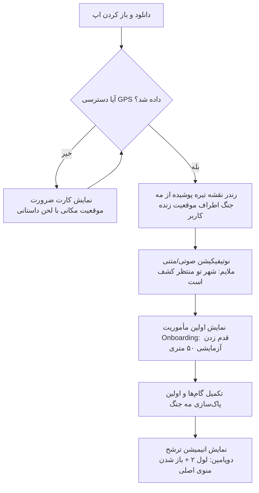
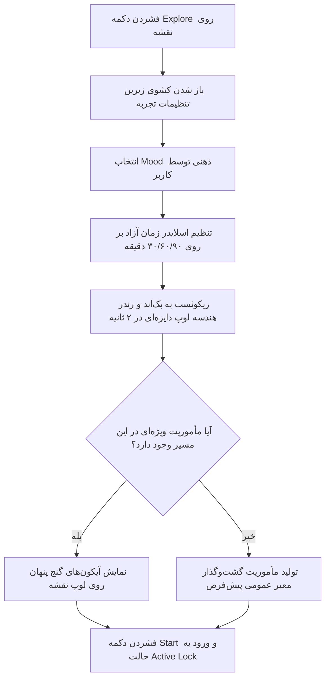
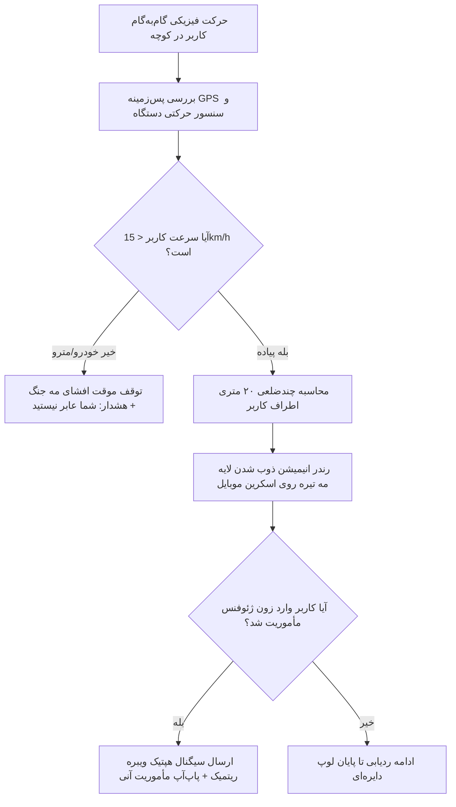
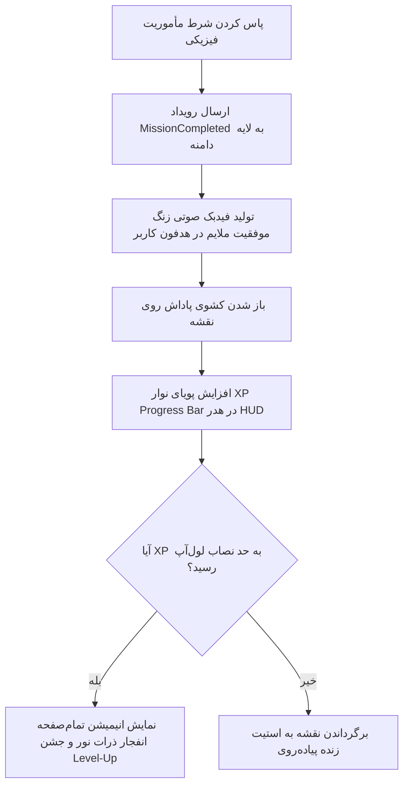

05_UX_Architecture.md

```markdown
# 05_UX_Architecture.md

## سند معماری تجربه کاربری (Comprehensive UX Architecture Specification)
**پروژه:** پلتفرم جهانی اکتشاف شهری بازی‌وارشده (Gamified Urban Exploration Platform)  
**نسخه:** ۱.۰.۰  
**وضعیت:** نسخه نهایی مصوب (پس از بازبینی متقاطع از دیدگاه طراح ارشد UX، رهبر محصول و روان‌شناس رفتارشناختی)  
**اسناد بالادستی مرجع:** `00_Product_Principles.md` تا `04_Domain_Model.md`

---

## ۱. ساختار اطلاعاتی تجربه کاربری (UX Information Architecture)

معماری اطلاعات این پلتفرم بر پایه مدل **«نقشه‌محور پویا» (Map-Centric Hybrid Model)** استوار است. نقشه، لایه زیرین زنده (Living Canvas) کل اپلیکیشن است و سایر بخش‌ها به صورت لایه‌های شناور (Floating Contextual Layers) یا لایه‌های کشویی (Bottom Sheets) بر روی آن سوار می‌شوند. این مدل از جابه‌جایی‌های سنتی بین صفحات مجزا جلوگیری کرده و حس غوطه‌وری در بازی (Immersion) را حفظ می‌کند.

### ساختار درختی و سلسله‌مراتب صفحات (Hierarchy)


```

[Living Canvas: MapLibre Base View]
├── Floating HUD (Heads-Up Display)
│    ├── Top Bar: Discovery Score, Level Badge & XP Progress Bar
│    └── Bottom Nav Bar (Floating Dock): [Map] [Missions Hub] [Profile & Inventory]
├── Experience Configuration Overlay (Bottom Sheet)
│    ├── Mood Picker (Relaxation, Architecture, Night Walk, Photography)
│    └── Time Allocation Slider (30, 60, 90 Mins)
├── Active Exploration Mode (Locked State HUD)
│    ├── Direction Compass & Distance/Time Remaining Card
│    ├── Next Cue/Waypoint Indicator
│    └── Dynamic Mission Cards (Geofenced Popups)
└── End-of-Walk Summary View
├── Statistical Breakdown (New Area Unfogged %, XP Gained)
└── Abstract Line-Art Poster Generator (Shareable View)

```

---

## ۲. مسیرهای اصلی کاربر (Core User Flows)

### مسیر اول: ورود و آماده‌سازی کاربر جدید (First-Time User Onboarding)



* **نقاط تصمیم‌گیری:** پذیرش دسترسی GPS توسط کاربر (بحرانی‌ترین نقطه اصطکاک).
* **نقاط ریسک (Drop-off):** اگر کاربر در لایه اول دسترسی لوکیشن را رد کند، محصول کاملاً فلج می‌شود. راهکار کاهش ریسک: استفاده از Onboarding داستانی پیش از پاپ‌آپ سیستم‌عامل.

### مسیر دوم: تولید مسیر و انتخاب مأموریت (Route Generation & Mission Selection)



* **نقاط تصمیم‌گیری:** انتخاب بین مودهای مختلف بر اساس ویب ذهنی کاربر.
* **نقاط ریسک (Drop-off):** تاخیر در تولید مسیر یا تولید مسیرهای نامتعادل. راهکار: استفاده از انیمیشن لودینگ بازی‌وارشده متناسب با مود انتخابی.

### مسیر سوم: ناوبری فعال و افشای نقشه (Exploration & Fog of War Reveal Flow)



### مسیر چهارم: تکمیل مأموریت و لایه پاداش (Mission Completion & Reward Flow)



---

## ۳. معماری صفحات و رابط کاربری متنی (Screen Architecture & Wireframes)

### ۱. صفحه اصلی: نمای زنده نقشه (Main Exploration Living Canvas)

* **هدف:** بستر اصلی تعامل کاربر با جهان فیزیکی و نمایشگر لایه مه جنگ.
* **ورودی‌ها:** موقعیت زنده مکانی، وضعیت دیتای تایل‌های نقشه بومی.
* **خروجی‌ها:** رندر بصری معابر افشاشده و نقاط در مه.
* **اکشن‌های کاربر:** حرکت روی نقشه، لمس نقاط جذاب (POI)، لمس دکمه Explore Dock.

#### وایرفریم متنی صفحه اصلی (Text-based Wireframe)

```
+-------------------------------------------------------------+
| [LVL 4]  (==== XP Progress Bar ==== 740/1000)  [Score: 4820]| <--- Floating Top HUD
+-------------------------------------------------------------+
|                                                             |
|       +--------+                                            |
|       |  Fog   |         X (POI: Hidden Historic House)     |
|       |   of   |        /                                   |
|       |  War   |       /                                    |
|       +--------+      / <--- Unfogged Route Path            |
|                      o (User Live Blue Dot)                 |
|                                                             |
|                                         [ (O) Recenter ]    |
+-------------------------------------------------------------+
|    +---------------------------------------------------+    |
|    |  [O] Map     |    [*] Missions    |   [V] Profile |    | <--- Floating Bottom Dock
|    +---------------------------------------------------+    |
+-------------------------------------------------------------+

```

### ۲. لایه کشویی تنظیمات تجربه (Experience Configuration Sheet)

* **هدف:** دریافت کانتکست ذهنی و زمان کاربر جهت تولید لوپ دایره‌ای.
* **ورودی‌ها:** کلیک روی دکمه Explore.
* **خروجی‌ها:** انتقال مود انتخابی و تایم به ماژول روتینگ.
* **Stateها:**
* *Loading State:* رندر انیمیشن یک قطب‌نمای اسرارآمیز در حال چرخش.
* *Success State:* نمایش لوپ رندر شده روی نقشه پشتی با متادیتای مسافت.


#### وایرفریم متنی تنظیمات تجربه

```
+-------------------------------------------------------------+
| [X] چقدر زمان داری؟                                         |
|  ( ) ۳۰ دقیقه          (*) ۴۵ دقیقه          ( ) ۶۰+ دقیقه   |
|  <----------------------[o]-------------------------------> | <--- Slider Component
+-------------------------------------------------------------+
| امروز چه مودی داری؟                                         |
|  +-----------------+  +-----------------+  +-------------+  |
|  | [*] آرامش و سکوت |  | [ ] خیابان تاریخ|  | [ ] عکاسی   |  | <--- Mood Cards
|  +-----------------+  +-----------------+  +-------------+  |
+-------------------------------------------------------------+
|                    [ تولید مسیر جادویی ]                    | <--- Action Button
+-------------------------------------------------------------+

```

### ۳. صفحه خلاصه و پوستر نهایی (End-of-Walk Art Gallery Screen)

* **هدف:** تبدیل دیتای فیزیکی پیاده‌روی به یک اثر هنری مینی‌مال قابل اشتراک‌گذاری جهت ویرالیته ارگانیک.
* **اکشن‌های کاربر:** کلیک روی دکمه استوری اینستاگرام، ذخیره در گالری محلی.

#### وایرفریم متنی پوستر خلاصه مسیر

```
+-------------------------------------------------------------+
| [X] ماجراجویی شماره ۱۲ به پایان رسید                       |
+-------------------------------------------------------------+
|    +---------------------------------------------------+    |
|    |                  __..---..__                      |    |
|    |              _.-'           '-._                  |    |
|    |            .'     ( لوپ هندسی    '.                |    |
|    |           /     انتزاعی مسیر طی    \               |    |
|    |          ;        شده کاربر )       ;              |    |
|    |           \                        /               |    |
|    |            '.                    .'                |    |
|    |              '-._            _.-'                  |    |
|    |                  `''---''`                        |    |
|    |                                                   |    |
|    |  TEHRAN EXPLORED - DISTRICT 6                     |    |
|    |  Distance: 4.2 KM | Area Unfogged: +1.2%          |    |
|    +---------------------------------------------------+    |
+-------------------------------------------------------------+
|               [ اشتراک‌گذاری در استوری ]                     |
+-------------------------------------------------------------+

```

---

## ۴. سیستم ناوبری (Navigation System)

پلتفرم به طور کامل از اصول **«ناوبری بر پایه ژست حرکتی و کانتکست» (Gesture & Map-centric Navigation)** تبعیت می‌کند.

* کاربر با سوییچ بین المان‌های Bottom Floating Dock بدون چرخیدن در منوهای تو در تو، لایه‌های دیتایی را روی نقشه فعال یا غیرفعال می‌کند.
* **ورود و خروج به حالت Active Run:** با فشردن دکمه «شروع ماجراجویی»، کل سیستم ناوبری عمومی قفل شده و به استیت "Exploration Locked View" هجرت می‌کند. در این حالت کاربر حق گشت‌وگذار در منوهای دیگر را ندارد تا تمرکز فیزیکی او روی پیاده‌روی حفظ شود. خروج از این حالت صرفاً با نگه‌داشتن ۳ ثانیه‌ای دکمه دایره‌ای "Hold to Pause/End" میسر است تا از لمس‌های تصادفی در جیب کاربر جلوگیری شود.

---

## ۵. اصول طراحی تعاملی و سنسوری (Interaction Design Principles)

تعامل کاربر با نقشه نباید شبیه به یک کار اداری یا چک کردن آدرس باشد؛ این تعامل باید حس کشف یک راز را القا کند.

### ۱. ماتریس ژست‌های حرکتی معتبر (Gestures)

* **Double Tap & Drag:** زوم یک‌دستی روی نقشه (مخصوص عابران پیاده که یک دستشان چتر یا لیوان قهوه است).
* **Two-Finger Rotation:** چرخاندن نقشه جهت هم‌راستا کردن فیزیکی قطب‌نما با ورودی کوچه‌ها.
* **Long Press on Unfogged Areas:** پین کردن و ثبت یادداشت کشف یا گزارش Crowdsourcing برای معابر عمومی.

### ۲. لایه بازخوردهای سنسوری (Multisensory Feedbacks)

| رویداد پلتفرم | بازخورد بصری (Visual) | بازخورد هپتیک (Haptic/ویبره) | بازخورد صوتی (Audio Cues) |
| --- | --- | --- | --- |
| **ورود به زون مأموریت** | پاپ‌آپ کارت مأموریت با افکت درخشش نور | دو ویبره کوتاه متوالی ($--$) | صدای زنگوله ملایم ارگانیک |
| **انحراف از مسیر لوپ** | تغییر رنگ خط لوپ از طلایی به خاکستری | یک ویبره ممتد لرزشی ($___$) | صدای زمزمه باد ملایم افکت منفی |
| **ذوب شدن مه جنگ** | انیمیشن پودر شدن ذرات تیره روی نقشه | میکرو ویبره تیک چرخ‌دنده‌ای | افکت صوتی شکستن یخ یا شیشه |

---

## ۶. تجربه کاربری لایه بازی‌وارسازی (Game UX Layer Specification)

طراحی گیمیفیکیشن بر پایه **«تئوری انگیزش خودتعیین‌کنندگی» (Self-Determination Theory)** بیلد شده است تا از اعتیاد کاذب دیجیتال دوری کرده و حس کارآمدی در دنیای واقعی را بالا ببرد.

* **UX مه جنگ (Fog of War Reveal):** مه نباید به صورت یک لایه جامد سیاه رندر شود. مه یک لایه گرادیان تیره، بلورین و نیمه‌شفاف (Blurry Frosted Glass) است. معابری که کاربر تا کنون نرفته، به صورت خطوط مبهم دیده می‌شوند. به محض حضور فیزیکی، مه با انیمیشنی شبیه به تبخیر شدن یا ذوب شدن یخ، رنگ ارگانیک و زنده نقشه زیرین را عریان می‌کند. این تضاد بصری تیره/روشن محرک اصلی غریزه کنجکاوی انسان است.
* **تجربه لول‌آپ (The Level-Up Celebration):** لول‌آپ هرگز یک بنر ساده نیست. با رسیدن به حد نصاب XP، کل نقشه برای ۳ ثانیه تاریک شده و پارتیکل‌های درخشان نور از موقعیت فعلی کاربر به سمت بالا پرتاب می‌شوند. یک تایتل گیمیفای‌شده جدید (مثلاً: *کوچه‌شناس منطقه ۶*) به همراه تم بصری نقشه جدید بازگشایی شده و به کاربر پاداش روانی آنی می‌دهد.

---

## ۷. تجربه کاربر در شرایط خطا و مرزها (Error & Edge UX Case Studies)

طبق لایه مشخصات ساختاری، تجربه کاربر در زمان بحران به صورت زیر سناریونویسی شده است:

### ۱. قطع کامل سیگنال اینترنت در دالان‌های شهری (Offline Walk Mode)

* **رفتار سیستم:** سیستم نباید هیچ پاپ‌آپ ارور یا دیالوگ قفل‌کننده‌ای صادر کند. المان Top HUD یک آیکون مینی‌مال قطب‌نما به رنگ خاکستری با تگ "Offline Tracking Active" نشان می‌دهد.
* **UX راهکار:** تمام دیتای هندسه لوپ جاری در لایه SQLite فرانت‌اند قفل است. مه جنگ کماکان در فرانت‌اند با اتکا به دیتای سنسور GPS پاک می‌شود و استیت‌ها پس از برقراری مجدد کانکشن، به صورت ناهمگام پکت‌بندی شده و به سرور ارسال می‌گردند. کاربر هیچ اصطکاکی در کشف شهر حس نخواهد کرد.

### ۲. انحراف فیزیکی کاربر از مسیر لوپ دایره‌ای (Off-Route Progression)

* **رفتار سیستم:** پلتفرم یک مسیریاب نیست که مدام بگوید "دور بزنید". پرسه‌زنی و خروج از مسیر ذات پلتفرم ماست.
* **UX راهکار:** سیستم خط اصلی لوپ را روی اسکرین کمرنگ می‌کند، اما هیچ نوتیفیکیشن هشداری صادر نمی‌کند. اگر کاربر بیش از ۲۰۰ متر از لوپ دور شد، یک ویجت کوچک مینی‌مال در پایین صفحه ظاهر می‌شود: "آیا راه جدیدی کشف می‌کنی؟ مایلستی یک لوپ بازگشت جدید از همین نقطه برایت بیابم؟" این ساختار حس آزادی کامل به کاربر می‌دهد.

```
+-------------------------------------------------------------+
| > [!] شما از لوپ اصلی خارج شده‌اید                               |
|   هیچ مشکلی نیست! کوچه‌های جدید را کشف کنید.                 |
|   [ تولید لوپ بازگشت جدید ]   [ ادامه پرسه‌زنی آزاد ]           | <--- Choice Context
+-------------------------------------------------------------+

```

---

## ۸. استراتژی تجربه کاربری ماندگار (Retention UX Strategy)

```
[RETENTION ENGINE]
 ├── Daily Hook  --> Daily Streak Multipier (ضریب افزایش دیسکاوری اسکور روزانه)
 ├── Weekly Loop --> Neighborhood Conquest (پاک‌سازی ۱۰۰٪ مه جنگ یک محله خاص)
 └── Monthly Goal--> Spatial Milestones & Physical Achievements (مدال‌های فیزیکی)

```

* **تثبیت روزانه (The Daily Hook):** استفاده از سیستم "Explore Streak". اگر کاربر هر روز حداقل ۵۰۰ متر در یک معبر جدید قدم بزند، ضریب پاداش XP او برای روز بعد افزایش می‌یابد. اگر یک روز قطع شود، ضریب به ۱ برمی‌گردد.
* **تثبیت هفتگی (The Weekly Loop):** تعریف چالش‌های محله‌ای. سیستم در ابتدای هفته پیشنهاد می‌دهد: "مه محله بهجت‌آباد را این هفته به بالای ۷۰٪ برسان و نشان ویژه معمار محله را باز کن." این هدف میان‌مدت انگیزه پیاده‌روی‌های آخر هفته را بیلد می‌کند.

---

## ۹. طراحی بر پایه عواطف و روان‌شناسی رفتارشناسی (Emotional Design)

ما از مدل **Hook Model (ادغام اشتیاق و پاداش داینامیک)** برای ایجاد حس افتخار و کشف استفاده می‌کنیم.

* **لحظه کشف یک "Hidden Gem":** زمانی که کاربر یک نقطه پنهان تگ‌شده دستی تاریخی را در شهر کشف می‌کند، کارت باز شده نباید شبیه به متن ویکی‌پدیا باشد. این کارت با استایل یک **«کارت بازی اسطوره‌ای قدیمی»** باز می‌شود؛ تصویر بنا با خطوط مینی‌مال رندر شده و داستان با لحنی رمزآلود نوشته شده است. این طراحی حس یک باستان‌شناس مدرن شهری را به کاربر القا می‌کند، نه یک عابر پیاده معمولی.

---

## ۱۰. دسترسی‌پذیری و کانتکست‌های خاص محیطی (Accessibility & Constraints)

* **تجربه پیاده‌روی شبانه (The Night Walk UX Mode):** به محض سوییچ به مود شب یا تشخیص سنسور نور محیط، تم نقشه به طور کامل به حالت Ultra-Dark هجرت می‌کند. تمام خطوط پرکنتراست حذف شده و از رنگ‌های نئون ملایم (فسفری و ارگانیک مایل به سبز) استفاده می‌شود تا از کور شدن چشمان کاربر در تاریکی معابر جلوگیری شده و امنیت او با تمرکز روی محیط فیزیکی حفظ شود.
* **کاربر توریست و مسافر (The Tourist Context):** زبان تمام لایه‌های داستانی و مأموریت‌ها با یک کلیک به انگلیسی سوییچ می‌کند و فاکتورهای امنیت معابر در الگوریتم تولید لوپ برای توریست‌ها ضریب دوبرابری می‌گیرد تا از ورود سهوی آن‌ها به زون‌های پرخطر ممانعت شود.

---

## ۱۱. تحلیل ریسک‌های تجربه کاربری (UX Risks & Mitigation)

* **ریسک پیچیدگی بیش از حد و تورم گیمیفیکیشن (Over-Gamification Trap):** اگر تعداد دکمه‌ها، امتیازها، مدال‌ها و پاپ‌آپ‌ها زیاد شود، اپلیکیشن شبیه به یک بازی کازینوی دیجیتال خسته‌کننده می‌شود و اصل اول قانون اساسی (تقدم تجربه کاربر بر پیچیدگی) نقض می‌گردد.
* **راهکار کاهش ریسک (Mitigation):** اعمال قانون **«افشای تدریجی فیچرها» (Progressive Disclosure)**. در لول ۱ تا ۳، کاربر هیچ‌چیز جز نقشه، مه جنگ و لوپ‌ساز ساده نمی‌بیند. سیستم مأموریت‌های پیشرفته، منوی مدال‌ها و لیدربوردها از لول ۴ به بعد به صورت لایه‌ای و بسیار ملایم در طول دو هفته باز می‌شوند تا مغز کاربر فرصت هضم اتمسفر پلتفرم را داشته باشد.

---

## ۱۲. ایده‌های آینده لایه تجربه کاربری (Future UX Ideas Bucket)

طبق قانون ۶ پلتفرم، ایده‌های نوآورانه تجربه کاربری در این بخش قرنطینه می‌شوند:

### ایده ۱: هدایت صوتی فضایی سه‌بعدی (Spatial Audio Homing Beacon)

* **شرح ایده:** در هدفون کاربر، یک صدای زمزمه طبیعت یا موزیک مینی‌مال پخش می‌شود. فرکانس و جهت صدا (چپ/راست) بر اساس ژیروسکوپ گوشی تنظیم می‌شود؛ هر چه کاربر به خروجی کوچه تاریخی نزدیک‌تر شود، صدا واضح‌تر و متمرکزتر می‌شود. کاربر بدون نگاه به اسکرین، با صدا مسیر را می‌یابد.
* **ارزش تجربه کاربری (UX Value):** رساندن فاکتور تعامل عمیق با شهر به سقف ممکن و حذف ۱۰۰ درصدی نیاز به نگاه به صفحه موبایل در حین پیاده‌روی.
* **پیچیدگی پیاده‌سازی:** بسیار بالا (نیاز به کالیبراسیون سنسورهای ۳ بعدی حرکتی و استریم داینامیک صدا در فلوتر).
* **اثر روی ماندگاری (Retention):** ایجاد تمایز جادویی در UX که کپی‌برداری از آن برای رقبا غیرممکن است.
* **نسخه پیشنهادی:** نسخه ۲.۲.۰ (فاز جهانی شدن پلتفرم).

---

## بخش‌های ساختاری و متادیتای سند (Metadata)

### Dependencies (وابستگی‌ها)

* این سند به طور مستقیم به نیازمندی‌های کارکردی ماژول‌های `Fog of War` و `Route Engine Core` در سند مشخصات محصول `03_Product_Specification.md` و استیت‌های تعریف شده در `04_Domain_Model.md` وابسته است.

### Affected Documents (مستندات تحت تأثیر)

تصویب این معماری تجربه کاربری، ساختار کدهای اسناد زیر را تحت تأثیر قرار می‌دهد:

* `06_UI_Style_Guide_Components.md` (تولید کامپوننت‌های فرانت‌اند فلوتر بر پایه فواصل و لایه‌های HUD این داک).
* `07_QA_UX_Testing_Scenarios.md` (تست‌نویسی سناریوهای ارور قطع پوزیشن بر پایه ماتریس بخش ۷).

### Assumptions (فرضیات اساسی)

* فرض شده است که کامپوننت رندرینگ فرانت‌اند (MapLibre) توانایی رندر پویا و ۶۰ فریم لایه چندضلعی‌های نیمه‌شفاف مه جنگ روی سیستم‌عامل‌های هدف را بدون لگ زدن گرافیکی داراست.

### Risks (ریسک‌های فنی و اجرایی)

* ریسک رد شدن دسترسی پوزیشن در پس‌زمینه (Background Location) توسط قوانین سخت‌گیرانه جدید سیستم‌عامل‌های iOS و Android که فلوهای ناهمگام آفلاین را با چالش مواجه می‌کند.

### Open Questions (سوالات باز)

* آیا در پایان مسیر، دکمه تولید پوستر خلاصه به صورت پیش‌فرض فعال باشد یا عابر پیاده باید گزینه ثبت نهایی را به صورت صریح لمس کند؟ (پیش‌نهاد فعلی سند: فعال‌سازی خودکار پاپ‌آپ پوستر به محض رسیدن به شعاع مبدا).

### Definition of Done (تعریف پایان کار سند)

* این سند زمانی Done تلقی می‌شود که تمام فلوهای اصلی عابر پیاده، وایرفریم‌های متنی HUD و ساختار رفتارهای لایه خطا به تایید طراح UI رسیده و اسکلت تجربه کاربری برای بیلد کامپوننت‌ها قفل گردد.

### Next Recommended Document (مستند پیشنهادی بعدی)

* **نام فایل:** `06_System_Architecture_and_API_Design.md`
* **دلیل:** اکنون که اسکلت تجربه کاربری (UX Structure)، فلوهای حرکت عابر، نیازمندی‌های کامپوننت‌های شناور نقشه و استیت‌های ماشین وضعیت خطا کاملاً قفل و ماتریکس شدند، زمان آن رسیده است که معمار سیستم لایه فنی نهایی شامل **طراحی اسکیماهای پایگاه داده فضایی PostGIS، کارهای ناهمگام Celery/Redis و پوینت‌های APIهای FastAPI** را بر پایه این فلوهای واقعی تجربه کاربری طراحی و مستند کند.

---

*این سند معماری تجربه کاربری با رعایت کامل اصول و قوانین ۱۲گانه همکاری تایید و قفل گردید.*

```

```