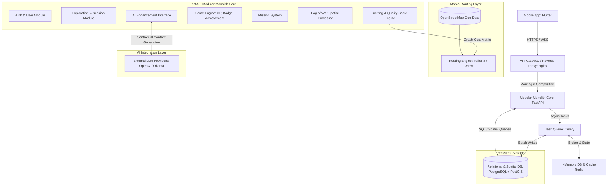
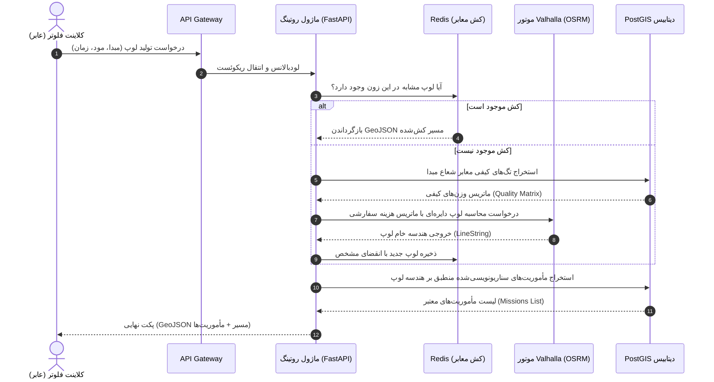
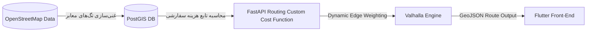

06_System_Architecture.md

```markdown
# 06_System_Architecture.md

## سند طراحی معماری سیستم (High-Level & Mid-Level System Architecture)
**پروژه:** پلتفرم جهانی اکتشاف شهری بازی‌وارشده (Gamified Urban Exploration Platform)  
**نسخه:** ۱.۰.۰  
**وضعیت:** نسخه نهایی مصوب (پس از بازبینی چهارمرحله‌ای از دیدگاه معمار ارشد نرم‌افزار، مهندس ارشد بک‌اند، مهندس سیستم‌های توزیع‌شده و CTO)  
**اسناد بالادستی مرجع:** `00_Product_Principles.md` تا `05_UX_Architecture.md`

---

## ۱. نمای کلی معماری کلان (High-Level Architecture Overview)

معماری پلتفرم در فاز MVP بر پایه الگوی **مونوپلیت ماژولار (Modular Monolith)** طراحی شده است. تمام مرزهای دامنه‌ای (Bounded Contexts) در سطح کد به صورت کاملاً ایزوله و ماژولار تعریف می‌شوند تا در فاز شتاب و مقیاس (Growth/Scale)، هجرت به **میکروسرویس‌های توزیع‌شده (Distributed Microservices)** بدون بازنویسی هسته کسب‌وکار امکان‌پذیر باشد. ارتباطات درون‌برنامه‌ای ماژول‌ها در فاز MVP از طریق Event Bus درون‌حافظه‌ای یا لایه دیتابیس مشترک مدیریت می‌شود، اما زیرساخت آماده سوییچ به یک Message Broker خارجی (مانند RabbitMQ/Kafka) است.



---

## ۲. اجزای سیستم (System Components Description)

### ۱. سرویس دروازه برنامه‌نویسی (API Gateway / Reverse Proxy)

* **تکنولوژی پیشنهادی:** Nginx / Traefik
* **مسئولیت:** لود بالانسینگ اولیه، مدیریت گواهی‌های TLS/SSL، فیلتر کردن هوشمند نرخ ریکوئست‌ها (Rate Limiting) بر پایه IP و JWT جهت جلوگیری از حملات DoS، و لایه هدایت ترافیک به Core.
* **ورودی‌ها:** ترافیک خام HTTPS / WSS از کلاینت فلوتر.
* **خروجی‌ها:** هدایت پکت‌ها به ماژول‌های داخلی FastAPI.
* **وابستگی‌ها:** ندارد.
* **مقیاس‌پذیری:** به صورت کاملاً Stateless با تکثیر اینستنس‌ها در لایه کانتینر (Kubernetes Horizontal Pod Autoscaling).

### ۲. ماژول مدیریت کاربران و احراز هویت (User & Auth Module)

* **تکنولوژی پیشنهادی:** Python + FastAPI + Jose (JWT)
* **مسئولیت:** ثبت نام، تایید هویت با سیستم رمز یکبار مصرف (OTP)، صدور و بازسازی توکن‌های امنیتی (Access/Refresh Token Tokens).
* **ورودی‌ها:** شماره همراه، کد تایید، توکن منقضی شده.
* **خروجی‌ها:** متادیتای پروفایل کاربر، پکت تاییدیه JWT Claims.
* **وابستگی‌ها:** `PostgreSQL (User Table)`.

### ۳. ماژول مدیریت نشست اکتشاف (Exploration & Session Module)

* **تکنولوژی پیشنهادی:** Python + FastAPI + Celery
* **مسئولیت:** پایش چرخه عمر پرسه‌زنی عابران پیاده، ردیابی پکت‌های پوزیشن ارسالی از کلاینت، و مدیریت استیت‌های Active/Paused/Completed.
* **ورودی‌ها:** جریان دیتای GPS لحظه‌ای کاربر ($X, Y, Speed, Timestamp$).
* **خروجی‌ها:** شناسه سشن فعال، سیگنال تغییر وضعیت سشن به لایه اگریگیت.
* **وابستگی‌ها:** `Redis`, `PostgreSQL`, `Game Engine Module`.

### ۴. موتور روتینگ کیفی (Routing & Quality Score Engine)

* **تکنولوژی پیشنهادی:** Valhalla / OSRM + Python NetworkX (برای فیلترهای ماتریسی کیفی)
* **مسئولیت:** تولید لوپ دایره‌ای متقارن فاقد مقصد بر پایه وزن‌دهی ماتریس کیفیت معابر ($Quality Score$).
* **ورودی‌ها:** مختصات مبدا فیزیکی کاربر، سقف زمان انتخابی (دقیقه)، شناسه مود روانی (Mood ID).
* **خروجی‌ها:** GeoJSON LineString شامل نقاط دقیق هندسی مسیر عابر پیاده.
* **وابستگی‌ها:** `PostGIS ( معابر OSM غنی‌شده)`, `Valhalla Instance`.

### ۵. ماژول پردازش مه جنگ (Fog of War Spatial Processor)

* **تکنولوژی پیشنهادی:** PostGIS (ST_Buffer, ST_Union) + Python Shapely
* **مسئولیت:** محاسبه چندضلعی‌های ۲۰ متری اطراف مسیر حرکتی عابر و ادغام (Merge) ناهمگام آن‌ها با چندضلعی کلان پیشرفت کاربر.
* **ورودی‌ها:** آرایه‌ای از نقاط موقعیت مکانی تاییدشده سشن.
* **خروجی‌ها:** مالتی‌پولیگون‌های جدید افشاشده (Unfogged Polygons Geometry).
* **وابستگی‌ها:** `PostgreSQL + PostGIS`, `Celery`.
* **مقیاس‌پذیری:** به دلیل سنگین بودن پردازش‌های هندسی فضایی، این ماژول کارهای خود را به صورت کارهای ناهمگام (Background Workers) در Celery اجرا می‌کند تا API قفل نشود.

### ۶. ماژول موتور بازی و پاداش (Game Engine Module)

* **تکنولوژی پیشنهادی:** Python Deterministic Rules Core
* **مسئولیت:** محاسبات دقیق افزایش XP بر پایه متراژ مه بازشده، اعطای مدال‌ها (Badges) و مدیریت دستاوردهای پیشرفت سطح کاربری (Level-up).
* **ورودی‌ها:** رویدادهای اتمام مأموریت، مساحت پولیگون‌های جدید مه جنگ.
* **خروجی‌ها:** وضعیت جدید سطح لول کاربر، توکن افتخارات اکانت.
* **وابستگی‌ها:** `PostgreSQL`.

---

## ۳. معماری جریان داده (Data Flow Architecture)

### جریان داده تولید لوپ و مأموریت (Route & Mission Generation Flow)



---

## ۴. معماری رویدادمحور (Event-Driven Architecture)

در فاز MVP برای حفظ سادگی زیرساخت و دوری از پیچیدگی‌های توزیع‌شده (قانون ۱۰ اصول محصول)، از **کارهای ناهمگام Celery بر پایه Redis** به عنوان یک معماری شبه‌رویدادمحور با تضمین پردازش ترتیبی استفاده می‌شود.

### لیست رویدادهای کلیدی و الگوی انتشار/اشتراک (Pub/Sub Event Registry)

| نام رویداد (Event Name) | ناشر رویداد (Publisher) | مشترکین رویداد (Subscribers) | اثر وضعی رویداد در سیستم |
| --- | --- | --- | --- |
| **ExplorationStarted** | Exploration Session | Fog of War Module, Analytics | ایجاد آبجکت موقت سشن در Redis، فعال‌سازی ردیاب پس‌زمینه کلاینت. |
| **PositionPackReceived** | Client Mobile GPS | Exploration Session, Fog of War | فیلتر کردن پرش‌های GPS، ارسال نقاط تاییدشده به صف پردازش چندضلعی مه. |
| **FogCleared** | Fog of War Module | Game Engine Module, Analytics | محاسبه متراژ جدید، افزایش دیسکاوری اسکور اکانت، بررسی شروط استریک روزانه. |
| **MissionCompleted** | Mission System | Game Engine Module, Notification | اعطای امتیاز XP مأموریت به دیتابیس، ارسال Push Notification موفقیت به فرانت‌اند. |
| **UserLevelUp** | Game Engine Module | Auth Profile, Notification | باز شدن تم‌های بصری جدید نقشه، ثبت رکورد در لیدربورد عمومی شهر. |

---

## ۵. معماری زمان‌واقعی (Real-Time Architecture Strategy)

پلتفرم به دلیل ماهیت حرکتی و گیمیفای‌شده، نیازمند ارتباطات کم‌تاخیر است، اما برای جلوگیری از مصرف شدید باتری گوشی عابر (ریسک‌های سند مشخصات)، استراتژی زیر اعمال می‌شود:

* **تکنولوژی ارتباطی:** استفاده از **WebSockets (WSS)** صرفاً در لایه **ماژول نشست فعال (Active Session)**. سایر بخش‌های پلتفرم از معماری استاندارد RESTful (HTTPS) تبعیت می‌کنند.
* **داده‌های زمان‌واقعی (Real-Time Data Streaming):** کلاینت فلوتر در حین پیاده‌روی، پکت‌های پوزیشن خود را هر ۵ ثانیه یکبار از طریق کانال WebSocket به سرور ارسال می‌کند.
* **سیستم Push Notification:** برای رویدادهایی که گوشی در جیب کاربر است (مانند باز شدن مأموریت یا لول‌آپ)، از **Firebase Cloud Messaging (FCM)** جهت بیدار کردن سنسورها یا پخش سیگنال‌های صوتی و هپتیک استفاده می‌شود.

---

## ۶. معماری نقشه و مسیریابی (Map & Routing Core Infrastructure)

هسته اصلی تمایز این محصول با گوگل‌مپ، سیستم روتینگ کیفی (Experience-based Routing) آن است.



### ۱. مکانیزم غنی‌سازی دیتای نقشه (Map Data Enrichment Layer)

دیتای خام معابر عابران پیاده از OpenStreetMap استخراج شده و در جداول PostGIS لود می‌شود. یک خط لوله دیتای پس‌زمینه (Data Pipeline)، یال‌های گراف معابر را بر اساس تگ‌های بومی غنی می‌کند:

* کوچه‌های بن‌بست مسکونی = ضریب آرامش بالا ($S_{calm} = +0.9$)
* معابر مجاور اتوبان‌ها و شاهراه‌ها = ضریب منفی ترافیک خودرویی ($S_{traffic} = -0.8$)
* معابر دارای تگ پارک یا پیاده‌راه درخت‌کاری شده = ضریب سرسبزی بالا ($S_{green} = +0.95$)

### ۲. اعمال توابع وزن‌دهی سفارشی (Custom Cost Matrix Computation)

موتور **Valhalla** به این دلیل انتخاب شده است که اجازه می‌دهد در زمان هیت شدن API، یک تابع هزینه داینامیک (Custom Cost Model) در قالب پکت‌های JSON به موتور ارسال شود. بر اساس مود انتخابی کاربر، وزن یال‌های گراف دگرگون شده و کوتاه‌ترین مسیر فیزیکی مخدوش می‌گردد تا «باکیفیت‌ترین و لذت‌بخش‌ترین لوپ» تولید شود.

---

## ۷. معماری موتور بازی پلتفرم (Game Engine Architecture)

موتور بازی (Game Logic Core) کاملاً در سمت بک‌اند (Server-side) کپسوله‌سازی شده است تا امکان تقلب (Cheat) و جعل امتیازها توسط کاربران به صفر برسد.

* **مدیریت استیت مأموریت‌ها (Mission State Engine):** موقعیت مکانی کاربر که از لایه WebSocket دریافت می‌شود، با پولیگون ژئوفنس مأموریت فعال در دیتابیس PostGIS با کوئری سبک `ST_Contains` پایش می‌شود. سرور وضعیت مأموریت را تغییر داده و از طریق رویداد `MissionCompleted` پاداش‌ها را آزاد می‌کند.
* **محاسبه ناهمگام افتخارات:** برای فرار از گره‌های تراکنشی دیتابیس (Database Deadlocks)، با اتمام مأموریت، امتیاز به صورت موقت در Redis ثبت شده و Celery Task موظف است در لایه‌های ثانویه دیتابیس PostgreSQL را آپدیت کرده و جدول لیدربورد کلان‌شهر را بازنویسی کند.

---

## ۸. معماری لایه هوش مصنوعی (AI Layer Architecture Interface)

طبق اصل ۵ قانون اساسی محصول (`00_Product_Principles.md`)، هوش مصنوعی مطلقاً هیچ نقشی در تولید هندسه مسیر یا منطق روتینگ گراف ندارد تا پایداری و امنیت فیزیکی عابر پیاده حفظ شود.

* **جایگاه AI در سیستم:** هوش مصنوعی به عنوان یک **سرویس دکوراتور پس‌زمینه (Asynchronous Content Decorator)** طراحی شده است.
* **نحوه عملکرد:** پس از اینکه موتور روتینگ کلاسیک لوپ هندسی را تولید کرد، متادیتای نقاط شاخص تاریخی و POIهای مسیر به عنوان کانتکست (Prompt Context) به یک مدل زبانی بزرگ (LLM) ارسال می‌شود. هوش مصنوعی وظیفه دارد یک داستان مینی‌مال، جذاب و پیوسته (Contextual Storytelling) برای آن لوپ تولید کند تا در لایه فرانت‌اند به کاربر نمایش داده شود.

---

## ۹. استراتژی مقیاس‌پذیری و توسعه جهانی (Scalability Design)

```
┌────────────────────────────────────────────────────────┐
│ CITY-AGNOSTIC DATA STORAGE STRATEGY                    │
├────────────────────────────────────────────────────────┤
│ PostgreSQL DB                                          │
│  ├── Table: cities (id, name, bounding_box)           │
│  ├── Table: osm_edges (id, city_id, geometry, tags)     │
│  └── Table: user_fog_maps (user_id, city_id, geometry) │
└────────────────────────────────────────────────────────┘

```

### ۱. معماری بدون وابستگی به مکان (City-Agnostic Scaling)

کلید مقیاس‌پذیری جهانی پلتفرم، ایزولاسیون دیتای فضاها بر پایه شناسه شهر (`city_id`) است. تمام جداول هندسی، معابر گراف، مأموریت‌ها و پولیگون‌های مه جنگ کاربران دارای ایندکس کامپوزیت فضایی متصل به `city_id` هستند. با ورود یک شهر جدید، دیتای OSM آن شهر بدون نیاز به تغییر در کدهای بک‌اند لود شده و سیستم فوراً آماده سرویس‌دهی در جغرافیای جدید می‌شود.

### ۲. رفع گلوگاه‌های اصلی (Bottleneck Mitigations)

* **گلوگاه محاسبات هندسی مه جنگ:** کوئری `ST_Union` بر روی پولیگون‌های تو در توی کلان کاربران به شدت سنگین است. **راهکار کاهش لود:** شهر به شبکه‌ای از مربع‌های کوچک فضایی ثابت (Spatial Tiles/Grids) تقسیم می‌شود. محاسبات مه جنگ فقط بر روی کاشی‌های فعال جاری کاربر انجام شده و کل دیتابیس فضایی در هر گام بازنویسی نمی‌شود.

---

## ۱۰. معماری امنیت و حفظ حریم خصوصی (Security & Privacy Architecture)

### ۱. پنهان‌سازی هویت حرکتی کاربران (Location Privacy Shield)

* **خط قرمز:** ذخیره کردن مسیر خطی حرکت عابران پیاده ($LineString$) به همراه تایم‌استمپ دقیق، ریسک‌های امنیتی شدیدی (ردیابی خانه و مسیر حرکت کاربران توسط هکرها) دارد.
* **راهکار معماری:** نقاط خام حرکتی پس از تایید سشن در حافظه فرار (Transient Memory) املت شده و فقط پولیگون‌های کلی مه جنگ (`MultiPolygon`) که فاقد برچسب زمان خطی حرکت هستند در دیتابیس فضایی ساو می‌شوند. هک شدن دیتابیس هرگز منجر به افشای لوکیشن لایو یا هیستوری حرکتی عابران نخواهد شد.

### ۲. جلوگیری از جعل موقعیت مکانی (GPS Spoofing Mitigation)

لایه بک‌اند FastAPI پکت‌های موقعیت مکانی را با الگوریتم‌های شتاب‌سنج فیزیکی انسان تطبیق می‌دهد. اگر فاصله زمانی دو پکت نشان‌دهنده سرعت حرکت غیرممکن برای عابر پیاده باشد، سیستم به صورت اتوماتیک سشن را Pause کرده و پاداش‌های آن پکت را باطل می‌کند.

---

## ۱۱. پایداری و مدیریت خطاها (Failure Handling Playbook)

* **سقوط موتور روتینگ یا Map Service:** در صورتی که موتور Valhalla در محاسبات لوپ داینامیک دچار تاخیر یا کرش شود، ماژول روتینگ FastAPI فوراً به بستر پلان B سوییچ می‌کند: فراخوانی مسیرهای استاتیک پرطرفدار قدیمی همان زون جغرافیایی از روی کش دیتابیس تا کاربر با ارور مواجه نگردد.
* **خرابی و قطعی لایه رویدادها (Event Bus Failures):** در صورت قطع اتصال با Redis، کارهای Celery در صف حافظه کلاینت فلوتر قفل می‌شوند. کلاینت دارای یک دیتابیس داخلی `SQLite` است که تمام کارهای افشای مه و مأموریت‌ها را کش کرده و پس از پایداری زیرساخت بک‌اند، آن‌ها را سنک می‌کند.

---

## ۱۲. معماری استقرار و زیرساخت فنی (Deployment & Infrastructure Architecture)

### ۱. فاز MVP: مونوپلیت ماژولار کانتینری

پلتفرم در فاز اول با ساختار Modular Monolith بر روی داکر (Docker) مستقر می‌شود. تمام سرویس‌ها (FastAPI, Redis, Valhalla) کانتینریایز شده و از طریق یک داک کامپوز بهینه‌سازی شده، بر روی یک اینستنس ابر لودبالانس می‌گردند.

### ۲. فاز Scale: آماده برای کوبرنتیز (Cloud-Native Kubernetes ready)

تمام کامپوننت‌ها به صورت کاملاً **Stateless** طراحی شده‌اند. دیتای وضعیت نشست‌ها تماماً در Redis نگهداری می‌شود. این تصمیم استراتژیک تضمین می‌کند که زیرساخت پلتفرم در فاز مقیاس بدون هیچ لود یا اصطکاکی آماده مهاجرت به پلتفرم ارکستریشن **Kubernetes** و توزیع در کلاسترهای Multi-Region جهانی باشد.

---

## ۱۳. موازنه‌های معماری (Architectural Trade-offs)

* **موازنه REST vs Event-driven:** ما برای کارهای سنتی اکانت (ورود/پروفایل) از REST استفاده کردیم تا سادگی حفظ شود، اما برای لایه ناوبری و گیمیفیکیشن کارهای ناهمگام Celery را برگزیدیم. این ترکیب، موازنه‌ای بهینه بین سرعت توسعه و تاب‌آوری سیستم توزیع‌شده ایجاد می‌کند.
* **موازنه محاسبات مه جنگ (Server-side vs Client-side):** رندر گرافیکی مه در فرانت‌اند (MapLibre) انجام می‌شود تا UX روان باشد، اما محاسبات قطعی و معتبرسازی پولیگون‌ها در بک‌اند (PostGIS) قفل شده است تا اصالت بازی و عدم امکان تقلب تضمین گردد.

---

## ۱۴. ریسک‌های معماری سیستم (Architecture Risks & Mitigations)

* **ریسک ۱: انفجار حجم داده‌های فضایی مالتی‌پولیگون‌ها (Geospatial Data Explosion)**
* *توضیح:* با رشد کاربران، حجم پولیگون‌های مه جنگ به شدت حجیم شده و کوئری‌های ST_Union سرور را متوقف خواهند کرد.
* *راهکار کاهش ریسک (Mitigation):* پیاده‌سازی تکنیک **ساده‌سازی هندسی (Douglas-Peucker Algorithm)** از طریق تابع `ST_Simplify` در دیتابیس PostGIS. سیستم به صورت دوره‌ای (مثلاً هفته‌ای یکبار در کارهای ناهمگام شبانه) خطوط چندضلعی‌های کاربران را بدون آسیب به فرم کلی نقشه، مینی‌مال و کم‌حجم می‌کند.


---

## بخش‌های ساختاری و متادیتای سند (Metadata)

### Dependencies (وابستگی‌ها)

* این سند معماری هندسه داده‌ای خود را مستقیماً از نیازمندی‌های ماژولار سند مشخصات محصول `03_Product_Specification.md` و مرزهای اگریگیت‌های طراحی شده در مدل دامنه `04_Domain_Model.md` استخراج کرده است.

### Affected Documents (مستندات تحت تأثیر)

تصویب این معماری کلان، اسناد زیر را به عنوان گام مهندسی بعدی تحت تأثیر قرار می‌دهد:

* `07_Database_Schema_PostGIS.md` (پیاده‌سازی فیزیکی جداول PostgreSQL بر پایه نیازمندی‌های ایندکس‌های فضایی این داک).
* `08_API_Contracts_FastAPI.md` (نگاشت پوینت‌های ورودی/خروجی بر پایه کانال‌های WebSocket و REST تعریف شده).

### Assumptions (فرضیات اساسی)

* فرض معماری بر این است که اینستنس Valhalla لود شده با دیتای OSM کلان‌شهری، توانایی پاسخ‌دهی به ریکوئست‌های تولید لوپ داینامیک را در زمان زیر ۱ ثانیه داراست.

### Open Questions (سوالات باز)

* آیا در فاز کلاسترینگ جهانی، دیتابیس فضایی PostGIS به صورت Read-Replicas توزیع‌شده منطقه‌ای (Geographic Sharding) بیلد شود یا لایه کشینگ Redis برای مدیریت لود ترافیک جهانی در فازهای اول کفایت می‌کند؟ (پیش‌نهاد فعلی: استفاده از دیتابیس مرکزی در MVP و مهاجرت به شاردینگ جغرافیایی در فاز ۳ نقشه راه).

### Definition of Done (تعریف پایان کار سند)

* این سند زمانی به وضعیت Done می‌رسد که لایه مدل ارتباطی سرویس‌ها، توابع سفارشی وزن‌دهی موتور روتینگ و استراتژی حفظ حریم خصوصی لوکیشن به تایید صریح CTO پروژه رسیده و آماده آغاز تسک‌نویسی استقرار و اسکیماهای دیتابیس باشد.

### Next Recommended Document (مستند پیشنهادی بعدی)

* **نام فایل:** `07_Database_Schema_Design_PostGIS.md`
* **دلیل:** اکنون که کل معماری سیستم (High-Level Architecture)، ساختار ماژول‌های مونوپلیت، سیستم ارتباطی زمان‌واقعی WebSocket، نحوه وزن‌دهی کیفی موتور روتینگ Valhalla و استراتژی امنیت حریم خصوصی لوکیشن کاملاً قفل و ماتریکس شدند، گام مهندسی بعدی و منطقی ترجمه مستقیم این معماری به زیرساخت ذخیره‌سازی داده یعنی **طراحی ساختار فیزیکی جداول دیتابیس، مشخصات فیلدها، اسکیماها و ایندکس‌های فضایی GiST در PostGIS** است.

---

*این سند جامع معماری سیستم با رعایت کامل اصول و قوانین ۱۲گانه همکاری تایید و قفل گردید.*

```

```