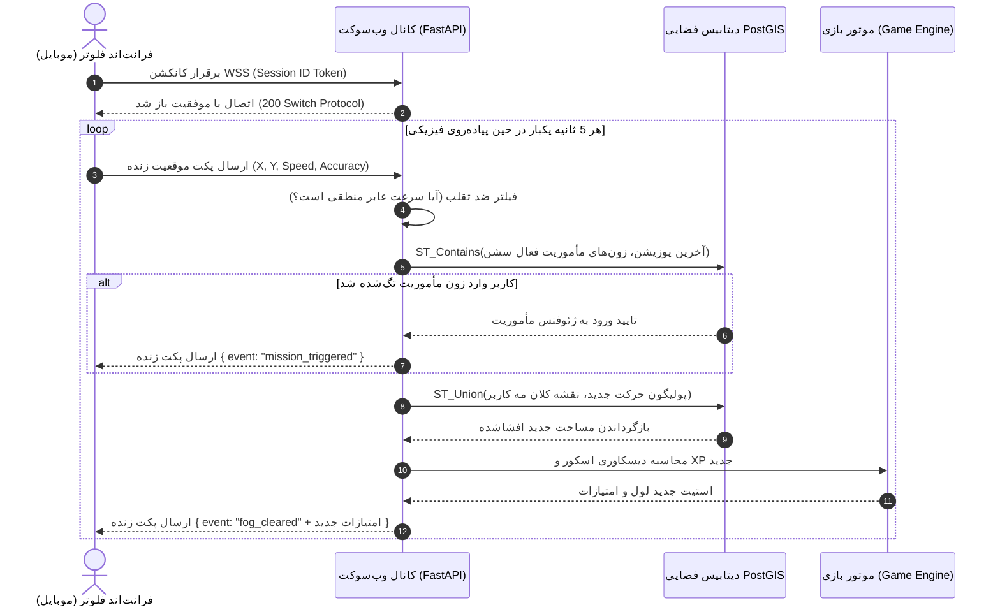

07_API_Design.md

```markdown
# 07_API_Design.md

## سند طراحی لایه واسط برنامه‌نویسی (Comprehensive API Architecture & Design Specification)
**پروژه:** پلتفرم جهانی اکتشاف شهری بازی‌وارشده (Gamified Urban Exploration Platform)  
**نسخه:** ۱.۰.۰  
**وضعیت:** نسخه نهایی مصوب (پس از ارزیابی ساختاری مهندس ارشد بک‌اند، معمار API، مهندس ارشد فرانت‌اند/موبایل و CTO)  
**اسناد بالادستی مرجع:** `00_Product_Principles.md` تا `06_System_Architecture.md`

---

## ۱. نمای کلی معماری ای‌پی‌آی (API Architecture Overview)

لایه ارتباطی پلتفرم بر پایه یک الگوی **ترکیبی (Hybrid API Model)** استوار است:
* **لایه مأموریت و داده (RESTful APIs):** برای ۹۰ درصد عملیات‌های استاتیک و تراکنشی سیستم (ثبت‌نام، احراز هویت، تاریخچه مسیرها، مشخصات پروفایل و لیدربورد) از معماری استاندارد REST بر بستر HTTPS استفاده می‌شود. JSON به عنوان فرمت پیش‌فرض تبادل داده انتخاب شده است.
* **لایه ناوبری و تعاملات زنده (WebSocket Event-Driven APIs):** برای ردیابی زنده موقعیت مکانی عابر، افشای آنی مه جنگ (Fog of War) و پایش لحظه‌ای ژئوفنس مأموریت‌ها، از ارتباطات دوطرفه زمان‌واقعی بر بستر WebSockets (WSS) استفاده می‌شود.

این ساختار ترکیبی مصرف باتری و پهنای باند را در فرانت‌اند فلوتر بهینه‌سازی کرده و تاخیر محاسبات فضایی را در بک‌اند FastAPI به حداقل ممکن می‌رساند.

---

## ۲. احراز هویت و امنیت نشست‌ها (Authentication & Authorization)

سیستم از استاندارد **OAuth2 مبتنی بر توکن‌های امنیتی بی‌حالت (Stateless JWT)** تبعیت می‌کند.

* **فرآیند ورود:** بر پایه رمز یکبار مصرف (OTP) از طریق پیامک/ایمیل طراحی شده است.
* **سیستم توکن‌های دوگانه (Dual-Token Strategy):**
  * `AccessToken`: دارای طول عمر کوتاه (۱۵ دقیقه) که در هدر تمام ریکوئست‌های تحت امنیتی به صورت `Authorization: Bearer <token>` ارسال می‌شود.
  * `RefreshToken`: دارای طول عمر بلند (۳۰ روز) که به صورت ایمن (HttpOnly Cookie در وب یا Secure Storage در موبایل) ذخیره می‌شود و صرفاً برای صدور AccessToken جدید کاربرد دارد.


```

[Client Mobile] ----(Send Expired AccessToken)----> [FastAPI Gateway] ----> (401 Unauthorized)
[Client Mobile] ----(Send Secure RefreshToken)----> [/api/v1/auth/refresh] -> (Issue New AccessToken)

```

---

## ۳. خلاصه ماژول‌های اصلی سرویس (Core API Modules Overview)

تمام پوینت‌های سیستم به صورت ماژولار تحت ساختار مسیردهی جهانی `/api/v1` پکیج‌بندی شده‌اند:

| ماژول (Module) | دامنه عملکردی (Domain Scope) | نوع پروتکل پایه (Protocol) |
| :--- | :--- | :--- |
| `/auth` | ثبت‌نام، ورود با OTP، نوسازی توکن‌ها | REST (HTTPS) |
| `/users` | مدیریت متادیتای پروفایل، لول، دستاوردها و لیدربوردها | REST (HTTPS) |
| `/routes` | تولید لوپ‌های داینامیک تجربه‌محور بر پایه Quality Score | REST (HTTPS) |
| `/exploration` | مدیریت نشست زنده پیاده‌روی و ردیابی لوکیشن عابر | REST + WebSockets (WSS) |
| `/missions` | فراخوانی مأموریت‌های زون جغرافیایی و پایش وضعیت گنج‌ها | REST (HTTPS) |

---

## ۴. طراحی تفصیلی نقاط اتصال سیستم (Endpoint Design Spec)

### ماژول احراز هویت (Auth Module)

#### ۱. درخواست ارسال کد یکبار مصرف (Request OTP)
* **URL:** `/api/v1/auth/otp/request`
* **Method:** `POST`
* **Authentication:** None (Public)
* **Rate Limiting:** 3 requests per 5 minutes per IP/Phone.
* **Request Body Schema:**
```json
{
  "$schema": "[http://json-schema.org/draft-07/schema#](http://json-schema.org/draft-07/schema#)",
  "type": "object",
  "properties": {
    "phone_number": { "type": "string", "pattern": "^09\\d{9}$" }
  },
  "required": ["phone_number"]
}

```

* **Response Body (200 OK):**

```json
{
  "status": "success",
  "message": "OTP code dispatched successfully.",
  "retry_after_seconds": 60
}

```

#### ۲. تایید کد و صدور توکن (Verify OTP)

* **URL:** `/api/v1/auth/otp/verify`
* **Method:** `POST`
* **Authentication:** None
* **Response Body (200 OK):**

```json
{
  "access_token": "eyJhbGciOiJIUzI1NiIsInR5cCI6IkpXVCJ9...",
  "refresh_token": "rfr_83jdm194kmad92k...",
  "token_type": "bearer",
  "expires_in": 900
}

```

* **Status Codes:** `200 OK`, `400 Bad Request (کد اشتباه)`, `429 Too Many Requests`.

---

### ماژول موتور تولید لوپ (Route Engine Module)

#### ۱. تولید لوپ دایره‌ای تجربه‌محور (Generate Contextual Loop)

* **URL:** `/api/v1/routes/generate`
* **Method:** `GET`
* **Authentication:** Required (Bearer Token)
* **Rate Limiting:** 10 requests per minute per user.
* **Query Parameters:**
* `origin_latitude` (Float, Required) - مثال: `35.7152`
* `origin_longitude` (Float, Required) - مثال: `51.4043`
* `duration_minutes` (Integer, Required) - گزینه‌ها: `30`, `60`, `90`
* `mood_id` (String, Required) - گزینه‌ها: `relaxation`, `architecture`, `photography`


* **Response Body (200 OK):**

```json
{
  "route_id": "8f3b7d1a-4c9e-4b2a-8f3c-7d1a4c9e4b2a",
  "total_distance_meters": 4250.5,
  "estimated_duration_minutes": 55,
  "quality_score": 8.7,
  "geometry": {
    "type": "LineString",
    "coordinates": [
      [51.4043, 35.7152],
      [51.4055, 35.7165],
      [51.4031, 35.7180],
      [51.4043, 35.7152]
    ]
  },
  "suggested_missions": [
    {
      "mission_id": "m_1092kmad",
      "title": "اسرار آجرکاری خانه پهلوی",
      "trigger_radius_meters": 20,
      "reward_xp": 250
    }
  ]
}

```

* **Status Codes:** `200 OK`, `400 Invalid Parameters`, `422 Unprocessable Entity (نبود معابر مناسب عابر پیاده در شعاع مبدا)`.

---

### ماژول مدیریت سشن و لوکیشن (Exploration & Session Module)

#### ۱. آغاز رسمی نشست پیاده‌روی (Start Exploration Session)

* **URL:** `/api/v1/exploration/start`
* **Method:** `POST`
* **Authentication:** Required
* **Request Body:**

```json
{
  "route_id": "8f3b7d1a-4c9e-4b2a-8f3c-7d1a4c9e4b2a"
}

```

* **Response Body (201 Created):**

```json
{
  "session_id": "sess_92kmad81jdm",
  "status": "active",
  "started_at": "2026-06-29T11:45:00Z",
  "websocket_sync_url": "wss://[api.urbanexplore.com/api/v1/exploration/ws/sess_92kmad81jdm](https://api.urbanexplore.com/api/v1/exploration/ws/sess_92kmad81jdm)"
}

```

---

## ۵. جریان ارتباطی در سطح وب‌سوکت (Real-Time WebSocket API Channel)

پس از شروع سشن، فرانت‌اند فلوتر یک کانال WebSocket با آدرس دریافتی متصل می‌کند. تمام تبادلات حرکتی و گیمیفیکیشن از این طریق استریم می‌شود.

### ساختار پکت پوزیشن ورودی کلاینت (Client Inbound Payload)

کلاینت هر ۵ ثانیه پکت زیر را به سرور Push می‌کند:

```json
{
  "event": "position_update",
  "payload": {
    "latitude": 35.7165,
    "longitude": 51.4055,
    "speed_kh": 4.2,
    "accuracy_meters": 5.0,
    "timestamp": "2026-06-29T11:45:05Z"
  }
}

```

### ساختار پکت‌های خروجی سرور به صورت زمان‌واقعی (Server Outbound Payloads)

#### الف: رویداد پاک‌سازی مه جنگ و کسب امتیاز (FogCleared Event)

```json
{
  "event": "fog_cleared",
  "payload": {
    "new_area_unfogged_sq_meters": 120.5,
    "discovery_score_increment": 15,
    "total_discovery_score": 4835,
    "unfogged_polygon_geojson": {
      "type": "Polygon",
      "coordinates": [[[51.4055, 35.7165], [51.4058, 35.7168], ...]]
    }
  }
}

```

#### ب: رویداد فعال‌سازی مأموریت فیزیکی حین معبر (MissionTriggered Event)

```json
{
  "event": "mission_triggered",
  "payload": {
    "mission_id": "m_1092kmad",
    "title": "اسرار آجرکاری خانه پهلوی",
    "description": "وارد حیاط عمارت فرعی شو و کتیبه بالای درب را اسکن کن.",
    "target_geofence": {
      "type": "Polygon",
      "coordinates": [[[51.4031, 35.7180], ...]]
    }
  }
}

```

---

## ۶. نمودارهای متوالی پوینت‌های کلیدی (Core User Flows - API Level)

### فلو لایو ناوبری، افشای مه و تکمیل مأموریت گنج شهری



---

## ۷. استراتژی یکپارچه مدیریت خطاها (Error Handling Strategy)

تمام خطاهای لایه REST و WebSocket از یک استاندارد ساختاری واحد پیروی می‌کنند تا فرانت‌اند بتواند بدون کرش کردن، فلوهای بازگشتی (Fallback) را رندر کند.

### فرمت استاندارد پکت خطا (Standard Error Response)

```json
{
  "error_code": "GEOSPATIAL_DATA_CLEAN_ERROR",
  "message": "The selected معبر is temporarily blocked due to municipal operations.",
  "timestamp": "2026-06-29T11:46:12Z",
  "details": {
    "blocked_segment_osm_id": 10928374,
    "suggested_action": "TRIGGER_REROUTING"
  }
}

```

### کاتالوگ کدهای خطای اختصاصی سیستم (Domain Error Registry)

* `AUTH_OTP_EXPIRED`: کد ورود منقضی شده است. کلاینت باید دکمه ارسال مجدد را فعال کند.
* `INVALID_MOVEMENT_SPEED`: سرعت کاربر فراتر از حد عابر پیاده است (کاهش ضدتقلب). سیستم افشای مه را متوقف می‌کند.
* `GPS_SIGNAL_LOW`: دقت سیگنال افزار GPS بالای ۳۰ متر است. فرانت‌اند باید به کاربر اخطار دهد به فضای باز برود.
* `MISSION_TIMEOUT`: زمان کلان لوپ تمام شده و مأموریت منقضی شده است.

---

## ۸. سیاست نسخه گذاری و پایداری (API Versioning Strategy)

* **الگوی نسخه‌گذاری:** استفاده از نسخه‌گذاری صریح در آدرس مسیر (URL-based Versioning) به صورت `/api/v1/...`.
* **سیاست پایداری و خروج (Deprecation Policy):** در صورت نیاز به تغییرات ساختاری و بیلد `/api/v2`، نسخه v1 حداقل به مدت ۶ ماه بر روی سرور نگهداری و ساپورت می‌شود. در پکت هدرهای نسخه قدیمی، تگ‌های `Deprecated: True` و `Sunset: 2026-12-31` ارسال می‌شوند تا تیم موبایل پاپ‌آپ لزوم آپدیت اپلیکیشن را مدیریت کند.

---

## ۹. کنترل نرخ مصرف و پرفورمنس (Rate Limiting & Caching)

* **پایگاه داده Redis Cache:** هندسه لوپ‌های تولیدشده پرطرفدار در مناطق شلوغ بر پایه کلید ترکیبی `round(lat, 3):round(lng, 3):duration:mood` به مدت ۶ ساعت کش می‌شوند تا از تکرار پردازش‌های سنگین گراف در موتور Valhalla جلوگیری شود.
* **Throttling لایه وب‌سوکت:** در صورتی که کلاینت به دلیل باگ فرانت‌اند در هر ثانیه بیش از ۱ پکت پوزیشن ارسال کند، سرور پکت‌های اضافی را بدون پردازش Drop کرده و اخطار ترافیک صادر می‌کند.

---

## ۱۰. لایه اتصال هوش مصنوعی به ای‌پی‌آی (AI Personalization APIs)

* **خط قرمز:** هوش مصنوعی هرگز هندسه مسیر را تغییر نمی‌دهد.
* **نقطه تزریق (Decoration Endpoints):** پس از قفل شدن لوپ، پوینت `/api/v1/routes/{id}/narrative` فراخوانی می‌شود که خروجی متنی داستانی و مینی‌مال بیلد شده توسط LLM را به صورت ناهمگام به بدنه کامپوزیشن لوپ الحاق می‌کند.

---

## ۱۱. ملاحظات کلاینت و توسعه موبایل (Client Integration Strategy)

* **مدیریت قطعی شبکه (Offline Sync Logic):** در صورت قطع اتصال WebSocket در حین حرکت، فلوتر موظف است پکت‌های پوزیشن را در دیتابیس `SQLite` داخلی موبایل با تگ وضعیت `synced = false` صف‌بندی (Queue) کند. به محض اتصال مجدد به شبکه، پوینت تراکنشی `/api/v1/exploration/sync-offline` فراخوانی شده و پکت‌ها به صورت فشرده (Gzip) آپلود می‌گردند تا دیتابیس فضایی PostGIS مه بازشده را به صورت یکپارچه بازسازی کند.

---

## ۱۲. موازنه تصمیمات لایه واسط (API Trade-offs)

* **موازنه REST vs GraphQL:** برای این پلتفرم معماری REST انتخاب شد؛ زیرا ساختار پکت‌های هندسی GeoJSON کاملاً استاندارد و ثابت هستند و نیازی به انعطاف‌پذیری اورفچینگ GraphQL در کلاینت موبایل ندارند. این تصمیم پیچیدگی کشینگ لایه شبکه را به شدت کاهش می‌دهد.
* **موازنه وب‌سوکت دوطرفه vs پولینگ کوتاه (WSS vs Short Polling):** استفاده از وب‌سوکت در سشن فعال هزینه هندبندینگ اولیه را دارد، اما پهنای باند و سربار پردازش لایه HTTP را در مقایسه با ارسال ریکوئست‌های مداوم ۵ ثانیه‌ای به سقف ممکن بهینه‌سازی می‌کند.

---

## بخش‌های ساختاری و متادیتای سند (Metadata)

### Dependencies (وابستگی‌ها)

* این سند دامنه‌های انوم و ماشین استیت‌های فیلدها را مستقیماً از مدل مفهومی دامنه `04_Domain_Model.md` و فلوهای بصری تعاملات را از `05_UX_Architecture.md` به لایه پوینت‌های فنی ترجمه کرده است.

### Affected Documents (مستندات تحت تأثیر)

تصویب این ساختار API، اسناد زیر را به عنوان گام بعدی تحت تأثیر قرار می‌دهد:

* `08_Database_Schema_PostGIS.md` (تطبیق فیلدهای کلید خارجی جداول با ساختار فیلدهای ورودی این داک).
* `09_Mobile_Network_Layer_Code.md` (بیلد مدل‌های دیتایی کلاس‌های دارت فرانت‌اند بر پایه اسکیماهای JSON این سند).

### Assumptions (فرضیات اساسی)

* فرض شده است که زیرساخت سرور و پروکسی Gateway اجازه باز ماندن کانکشن‌های WebSocket را بدون قطع اجباری کانکشن (Idle Timeout) برای حداکثر ۹۰ دقیقه (سقف تایم لوپ پیاده‌روی) صادر می‌کند.

### Risks (ریسک‌های فنی)

* ریسک Latency محاسبات فضایی چندضلعی‌ها در لایه دیتابیس در زمان هیت همزمان هزاران پکت وب‌سوکت، که حل آن منوط به لودبالانس بهینه کارهای پس‌زمینه در Celery است.

### Next Recommended Document (مستند پیشنهادی بعدی)

* **نام فایل:** `08_Database_Schema_Design_PostGIS.md`
* **دلیل:** اکنون که تمام پوینت‌های ارتباطی REST، ساختار پکت‌های زمان‌واقعی شبکه WebSocket، اسکیماهای استاندارد JSON، فلوهای ترتیبی توزیع پاداش‌ها و ساختار کدهای خطا کاملاً قفل و ماتریکس شدند، گام مهندسی بعدی و نهایی، طراحی لایه فیزیکی ماندگاری داده‌ها یعنی **طراحی ساختار جداول دیتابیس، ایندکس‌های فضایی GiST، کلیدهای خارجی و ارتباطات دیتابیسی در PostGIS** بر پایه نیازهای اطلاعاتی این پوینت‌های طراحی‌شده است.

---

*این سند جامع طراحی معماری و مشخصات API پلتفرم با رعایت کامل اصول و قوانین ۱۲گانه همکاری تایید و قفل گردید.*

```

```