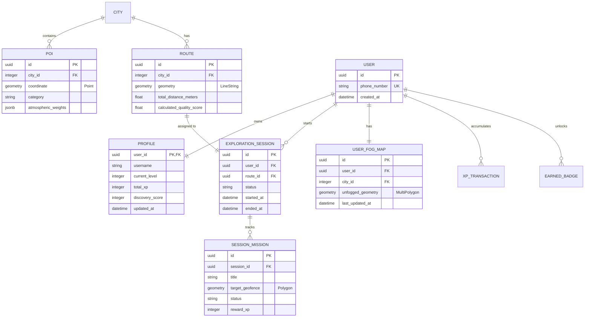
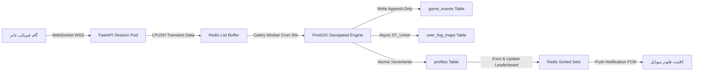

08_Data_Architecture_and_Database_Design.md

```markdown
# 08_Data_Architecture_and_Database_Design.md

## سند طراحی معماری داده و پایگاه داده (Comprehensive Data Architecture & Database Design Specification)
**پروژه:** پلتفرم جهانی اکتشاف شهری بازی‌وارشده (Gamified Urban Exploration Platform)  
**نسخه:** ۱.۰.۰  
**وضعیت:** نسخه نهایی مصوب (پس از بازبینی چهارمرحله‌ای از دیدگاه معمار ارشد داده، مهندس ارشد بک‌اند، مهندس سیستم‌های توزیع‌شده و CTO)  
**اسناد بالادستی مرجع:** `00_Product_Principles.md` تا `07_API_Design.md`

---

## ۱. نمای کلی معماری داده (Data Architecture Overview)

طراحی معماری داده این پلتفرم بر اساس اصول **ذخیره‌سازی چندگانه محلی (Polyglot Persistence)** بیلد شده است تا بتواند چالش‌های متمایز داده‌های مکانی، تراکنش‌های گیمیفیکیشن زمان‌واقعی و جریان مداوم دیتای پوزیشن عابران را در مقیاس جهانی مدیریت کند.

### دسته‌بندی لایه‌های داده و دیتابیس‌های انتخابی

* **داده‌های ساختاریافته و مکانی (Relational & Geospatial Data):** پایگاه داده **PostgreSQL به همراه افزونه PostGIS** به عنوان منبع واحد حقیقت (Single Source of Truth) برای ذخیره اطلاعات کاربران، مأموریت‌ها، ساختار توپولوژی گراف معابر شهر و چندضلعی‌های مه جنگ انتخاب شده است.
* **داده‌های زمان‌واقعی و کش (Ephemeral & Cache Data):** پایگاه داده درون‌حافظه‌ای **Redis** برای مدیریت سشن‌های فعال، کش تایل‌های نقشه، بافر پکت‌های موقعیت مکانی لایو و صف‌بندی کارهای Celery استفاده می‌شود.
* **داده‌های رویداد و وقایع گیمیفیکیشن (Event Data):** لایه لاگ تراکنشی ناهمگام و سیستم رویدادمحور سیستم بر بستر **PostgreSQL (تبدیل به ساختار Append-Only Log)** به صورت سبک پیاده‌سازی شده است تا تاریخچه پیشرفت (XP/Badges) قابلیت بازپخش (Replay) داشته باشد.

---

## ۲. استراتژی انتخاب پایگاه‌های داده (Database Selection Strategy)

| نوع دیتابیس | نقش در سیستم | دلیل انتخاب | محدودیت‌ها و راهکار |
| :--- | :--- | :--- | :--- |
| **PostgreSQL + PostGIS** | ذخیره تراکشنال سیستم و لایه هندسی فضایی | پشتیبانی بی‌نظیر از استانداردهای OGC، ایندکس‌های فضایی GiST و توابع پیشرفته تحلیل پولیگون‌ها. | محاسبات سنگین `ST_Union`. راهکار: کاشی‌بندی (Grid Partitioning) داده‌ها. |
| **Redis** | مدیریت حالت (State) زمان‌واقعی و کشینگ | سرعت زیر میلی‌ثانیه، پشتیبانی نیتیو از TTL، ساختارهای داده‌ای Pub/Sub و Geospatial (GEOADD). | فرار بودن داده در حافظه رم. راهکار: فعال‌سازی دیسک Persistence به صورت AOF برای داده‌های سشن. |

---

## ۳. نمودار ارتباطی موجودیت‌ها (Entity Relationship ER Diagram)



---

## ۴. مشخصات جداول و اسکیماهای اصلی (Core Schema Specifications)

### ۱. جدول پروفایل کاربران (profiles)

* **هدف:** نگهداری استیت‌های گیمیفای‌شده و سطح پیشرفت انباشته‌شده عابر.

```sql
CREATE TABLE profiles (
    user_id UUID PRIMARY KEY REFERENCES users(id) ON DELETE CASCADE,
    username VARCHAR(50) NOT NULL,
    current_level INT DEFAULT 1 NOT NULL,
    total_xp INT DEFAULT 0 NOT NULL,
    discovery_score INT DEFAULT 0 NOT NULL,
    updated_at TIMESTAMP WITH TIME ZONE DEFAULT CURRENT_TIMESTAMP NOT NULL
);
CREATE INDEX idx_profiles_xp ON profiles (total_xp DESC);
CREATE INDEX idx_profiles_discovery ON profiles (discovery_score DESC);

```

### ۲. جدول مسیرهای تجربه‌محور (routes)

* **هدف:** ذخیره‌سازی لایه هندسی لوپ‌های تولید شده توسط موتور روتینگ.

```sql
CREATE TABLE routes (
    id UUID PRIMARY KEY,
    city_id INT NOT NULL,
    geometry GEOMETRY(LineString, 4326) NOT NULL,
    total_distance_meters NUMERIC(10, 2) NOT NULL,
    calculated_quality_score NUMERIC(4, 2) NOT NULL,
    created_at TIMESTAMP WITH TIME ZONE DEFAULT CURRENT_TIMESTAMP NOT NULL
);
CREATE INDEX idx_routes_city ON routes (city_id);
CREATE INDEX idx_routes_geometry ON routes USING GIST (geometry);

```

### ۳. جدول نقشه مه جنگ کاربران (user_fog_maps)

* **هدف:** ردیابی کلان‌شهر افشاشده انحصاری هر حساب کاربری.

```sql
CREATE TABLE user_fog_maps (
    id UUID PRIMARY KEY,
    user_id UUID NOT NULL REFERENCES users(id) ON DELETE CASCADE,
    city_id INT NOT NULL,
    unfogged_geometry GEOMETRY(MultiPolygon, 4326) NOT NULL,
    last_updated_at TIMESTAMP WITH TIME ZONE DEFAULT CURRENT_TIMESTAMP NOT NULL,
    CONSTRAINT uk_user_city UNIQUE (user_id, city_id)
);
CREATE INDEX idx_user_fog_spatial ON user_fog_maps USING GIST (unfogged_geometry);

```

### ۴. جدول نقاط جذاب و دنج شهری (pois)

* **هدف:** ذخیره گره‌های غنی‌شده نقشه برای محاسبات توابع هزینه روتینگ.

```sql
CREATE TABLE pois (
    id UUID PRIMARY KEY,
    city_id INT NOT NULL,
    coordinate GEOMETRY(Point, 4326) NOT NULL,
    category VARCHAR(30) NOT NULL,
    atmospheric_weights JSONB NOT NULL, -- شامل کلیدهای S_green, S_calm, S_visual
    is_hidden_gem BOOLEAN DEFAULT FALSE NOT NULL,
    created_at TIMESTAMP WITH TIME ZONE DEFAULT CURRENT_TIMESTAMP NOT NULL
);
CREATE INDEX idx_pois_spatial ON pois USING GIST (coordinate);
CREATE INDEX idx_pois_category_weights ON pois USING GIN (atmospheric_weights);

```

---

## ۵. مدل داده‌ای معماری فضایی و جغرافیایی (Geospatial Data Model Specification)

کل دیتای مکانی پلتفرم بر پایه استاندارد سیستم مختصات جهانی **WGS 84 (SRID 4326)** پایه‌ریزی شده است. برای اجرای کوئری‌های محاسباتی فواصل بر حسب متر، دیتای فضایی در حین پردازش به طور داینامیک به ساختار Geography کج می‌شود یا از توابع پیش‌فرض بهینه‌سازی شده استفاده می‌گردد.

### ۱. پیاده‌سازی مکانیزم افشای لایه مه جنگ (Fog of War Real-time Compute)

به محض اتمام سشن یا در کارهای ناهمگام پکت‌بندی شده، نقاط پوزیشن عابر تبدیل به یک بافر ۲۰ متری شده و با ساختار MultiPolygon قبلی کاربر ادغام می‌شود.

```sql
-- کوئری نمونه برای اورلپ و ادغام پولیگون جدید با نقشه کلان کاربر و محاسبه مساحت جدید بر حسب متر مربع
WITH new_buffer AS (
    SELECT ST_Buffer(ST_SetSRID(ST_GeomFromText('LINESTRING(51.4043 35.7152, 51.4055 35.7165)'), 4326)::geography, 20)::geometry AS geom
),
updated_map AS (
    UPDATE user_fog_maps
    SET unfogged_geometry = ST_Multi(ST_Union(unfogged_geometry, new_buffer.geom)),
        last_updated_at = CURRENT_TIMESTAMP
    FROM new_buffer
    WHERE user_id = 'user_uuid_here' AND city_id = 1
    RETURNING ST_Area(unfogged_geometry::geography) AS total_area
)
SELECT total_area FROM updated_map;

```

---

## ۶. مدل داده‌ای رویدادها و وقایع پیشرفت (Event Data Model)

سیستم رویدادهای گیمیفیکیشن را در یک جدول Append-Only ذخیره می‌کند تا امنیت تراکنش‌های امتیازدهی تضمین شده و قابلیت Replay لول اکانت‌ها مهیا باشد.

```sql
CREATE TABLE game_events (
    id BIGSERIAL PRIMARY KEY,
    user_id UUID NOT NULL,
    event_type VARCHAR(50) NOT NULL, -- 'FOG_CLEARED', 'MISSION_COMPLETED'
    payload JSONB NOT NULL,
    created_at TIMESTAMP WITH TIME ZONE DEFAULT CURRENT_TIMESTAMP NOT NULL
);
CREATE INDEX idx_game_events_user_type ON game_events (user_id, event_type);

```

* **سیاست نگهداری (Retention Policy):** دائمی (Permanent) برای کل رویدادهای مالی و امتیازی لول‌آپ جهت فرار از تقلب.

---

## ۷. استراتژی کشینگ لایه‌ها (In-Memory Caching Strategy)

پایگاه داده Redis به عنوان هاب لایه کشینگ با متدهای ساختاری زیر کانفیگ می‌شود:

* **کش لوپ‌های روتینگ:** هندسه لوپ‌های داینامیک مناطق شلوغ بر پایه کلید `route:cache:<city_id>:<grid_id>:<duration>:<mood>` با ساختار هَش و هدر TTL برابر با ۶ ساعت قفل می‌شود.
* **بافر لوکیشن کلاینت:** پکت‌های ۵ ثانیه‌ای لوکیشن عابر در حین سشن فعال ابتدا به ساختار `LIST` در Redis با کلید `session:trace:<session_id>` پوش (PUSH) می‌شوند. کارهای Celery هر ۳۰ ثانیه پکت‌ها را پاپ (POP) کرده و پردازش فضایی PostGIS را به صورت Bulk انجام می‌دهند تا دیتابیس زیر ضربه کوئری‌های مداوم ثانیه‌ای نرود.

---

## ۸. معماری جریان انتقال داده (Data Flow Architecture Diagram)

جریان حرکت داده از گام فیزیکی کاربر تا لایه‌های ماندگاری و کش سیستم به صورت زیر ارکستریت می‌شود:



---

## ۹. استراتژی مقیاس‌پذیری زیرساخت داده (Data Scalability Strategy)

برای مدیریت لایه داده‌ها در میلیون‌ها کاربر و فرار از گلوگاه محاسباتی PostGIS، استراتژی‌های زیر اعمال می‌گردد:

* **افراز پولیگون‌های مه جنگ (Spatial Grid Partitioning):** پولیگون کلان نقشه هر کاربر به صورت یک لایه پیوسته ذخیره نمی‌شود. هر شهر به شبکه‌ای از مربع‌های فیزیکی ۲ کیلومتر در ۲ کیلومتر با شناسه `grid_id` تقسیم می‌شود. جدول `user_fog_maps` بر پایه کامپوزیت `(user_id, city_id, grid_id)` افراز (Partition) می‌گردد. کوئری‌های `ST_Union` فقط روی کاشی کوچک فعال جاری کاربر پردازش می‌شوند که حجم محاسبات هندسی گرافیکی را همواره ثابت و سبک نگاه می‌دارد.
* **تفکیک لایه‌های خواندن/نوشتن (Read/Write Pooling):** استفاده از یک دیتابیس Master برای عملیات‌های نوشتن سشن و کارهای پس‌زمینه، و دو دیتابیس Read-Replicas برای پاسخ‌دهی به ریکوئست‌های سبک لایه‌های رندرینگ فرانت‌اند و لیدربوردها.

---

## ۱۰. ملاحظات امنیتی و حفظ حریم خصوصی معابر (Data Privacy & Guardrails)

* **امحای پکت‌های خطی (Transient Location Shredding):** طبق قانون اساسی محصول، ذخیره مسیر خطی عریان حرکت کاربر ممنوع است. لیست پوزیشن‌های فرار ذخیره‌شده در `Redis List Buffer` بلافاصله پس از پردازش توسط Celery Worker و تبدیل به پولیگون بافر غیرخطی مه جنگ، با دستور `DEL` کاملاً امحا می‌گردند. هیچ اثری از تایم‌استمپ خطی حرکت عابر در سیستم باقی نمی‌ماند.
* **رمزنگاری داده‌های حساس در استراحت (Encryption at Rest):** ستون‌های مختصات مبدا خانگی یا اطلاعات پروفایل کاربران با الگوریتم AES-256 در لایه Storage دیتابیس انکریپت می‌شوند.

---

## بخش‌های ساختاری و متادیتای سند (Metadata)

### Dependencies (وابستگی‌ها)

* این سند معماری داده‌های خود را مستقیماً از نگاشت اگریگیت‌های طراحی شده در مدل دامنه `04_Domain_Model.md` و پوینت‌های فنی بیلد شده در مشخصات ای‌پی‌آی `07_API_Design.md` استخراج کرده است.

### Affected Documents (مستندات تحت تأثیر)

تصویب این ساختار، اسناد زیر را به عنوان گام مهندسی بعدی تحت تأثیر قرار می‌دهد:

* `09_Database_Migration_Scripts.md` (تولید کدهای خالص مهاجرت SQL/Alembic بر پایه جداول این داک).
* `10_Integration_Tests_Data_Layer.md` (تست‌نویسی شروط تغییرناپذیر Invariants فضایی روی PostGIS).

### Assumptions (فرضیات اساسی)

* فرض مهندسی بر این است که اکستنشن PostGIS نصب شده بر روی پایگاه داده PostgreSQL، توانایی هندلینگ بهینه کارهای هندسی فضایی کاشی‌بندی شده را تحت لود بالا داراست.

### Risks (ریسک‌های فنی داده)

* ریسک رشد بی‌رویه حجم حافظه Redis به دلیل انباشت پکت‌های پوزیشن در زمان قطعی یا تاخیر Workers، که حل آن منوط به مانیتورینگ دقیق صف‌ها با ابزارهای Alerting است.

### Next Recommended Document (مستند پیشنهادی بعدی)

* **نام فایل:** `09_Database_Migration_and_Implementation_Scripts.md`
* **دلیل:** اکنون که کل اسکیماهای فیزیکی جداول دیتابیس، مشخصات فیلدها، ارتباطات لایه تراکشنال، مکانیسم‌های ریاضی پردازش پولیگون‌های مه جنگ در PostGIS و کلاسترینگ لایه‌های کش Redis کاملاً قفل و مستند شدند، گام مهندسی بعدی و نهایی، تولید کدهای پیاده‌سازی یعنی **اسکریپت‌های خالص کدهای اسکیما دیتابیس و کارهای مهاجرت ساختاری (Alembic / SQL DDL Migration Scripts)** جهت بیلد لایه داده زیرساخت پروژه است.

---

*این سند جامع طراحی معماری و مشخصات پایگاه داده پلتفرم با رعایت کامل اصول و قوانین ۱۲گانه همکاری تایید و قفل گردید.*

```

```