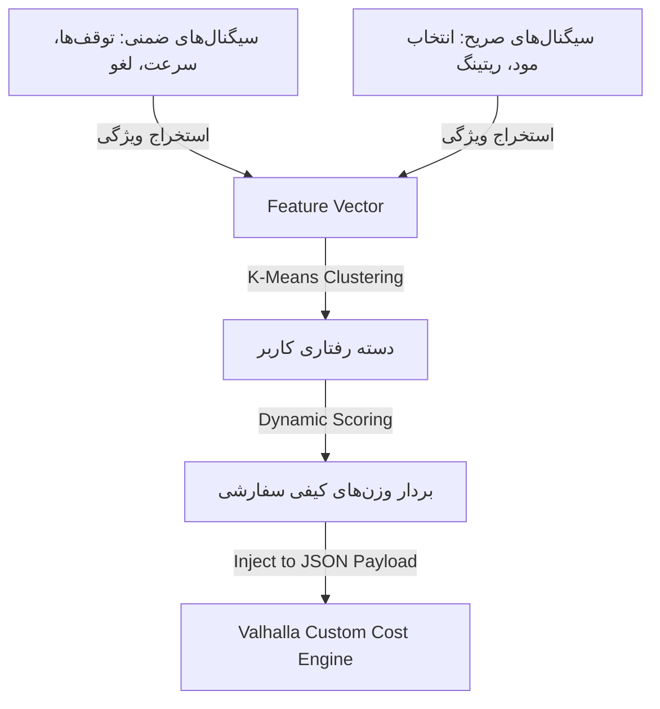
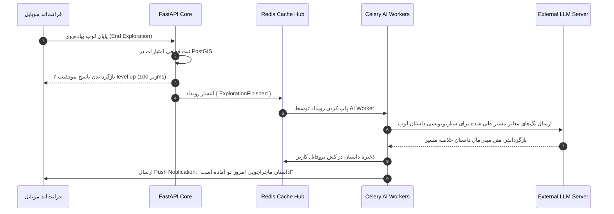

09_AI_And_Game_Intelligence_Architecture.md

```markdown
# 09_AI_And_Game_Intelligence_Architecture.md

## سند معماری هوش مصنوعی و هوشمندی بازی (Comprehensive AI & Game Intelligence Architecture Specification)
**پروژه:** پلتفرم جهانی اکتشاف شهری بازی‌وارشده (Gamified Urban Exploration Platform)  
**نسخه:** ۱.۰.۰  
**وضعیت:** نسخه نهایی مصوب (پس از بازبینی چهارگانه‌ی مهندس ارشد هوش مصنوعی، طراح سیستم‌های بازی، مهندس ارشد بک‌اند و CTO)  
**اسناد بالادستی مرجع:** `00_Product_Principles.md` تا `08_Data_Architecture_and_Database_Design.md`

---

## ۱. نمای کلی سیستم هوش مصنوعی (AI System Overview)

در این پلتفرم، هوش مصنوعی یک **«لایه تقویت‌کننده تجربه» (Enhancement & Personalization Layer)** است، نه لایه‌ی زیرساختی و ساختاری محاسبات. برای تضمین پایداری سیستم، امنیت عابران فیزیکی و جلوگیری از خطای توهم (Hallucination)، کل سیستم بر پایه یک **«مدل هوشمندی ترکیبی» (Hybrid Intelligence Model)** استوار است.

### مرزبندی سخت‌افزاری و الگوریتمی وظایف هوش مصنوعی

* **چه کارهایی را AI انجام می‌دهد؟** شخصی‌سازی فاکتورهای وزن‌دهی کیفی معابر، سناریونویسی و داستان‌سرایی محتوایی برای نقاط جذاب (POI)، کلاستربندی رفتاری کاربران، پیش‌بینی الگوهای ریزش (Churn) و بهینه‌سازی توزیع داینامیک مأموریت‌های تفریحی.
* **چه کارهایی را AI مطلقاً نباید انجام دهد؟** هوش مصنوعی حق تولید مستقیم هندسه مسیر، ناوبری عریان و تایید فیزیکی باز شدن معابر روی گراف را ندارد.
* **تفاوت لایه AI با موتور روتینگ اصلی (Core Routing Engine):** موتور روتینگ اصلی یک سیستم کاملاً قطعی (Deterministic) بر پایه قوانین گراف و دیتای PostGIS است. لایه هوش مصنوعی صرفاً پارامترها و وزن‌های ورودی ($Weights$) این موتور کلاسیک را بر اساس کانتکست روانی و رفتاری کاربر تغییر می‌دهد تا خروجی لوپ شخصی‌سازی شود.


```

┌────────────────────────────────────────────────────────┐
│             HYBRID INTELLIGENCE PIPELINE               │
├────────────────────────────────────────────────────────┤
│  [User Context & Behavior Profile]  <-- AI Layer       │
│                  │                                     │
│                  v (Dynamic Quality Weights)           │
│  [PostGIS + Valhalla Deterministic Graph] <-- Core Engine│
└────────────────────────────────────────────────────────┘

```

---

## ۲. تفکیک ماژول‌های هوشمندی سیستم (System Breakdown)

### ۱. موتور شخصی‌سازی و پیشنهاد (User Personalization & Recommendation Engine)
* **هدف:** استخراج ترجیحات پنهان کاربر و تنظیم داینامیک ماتریس کیفیت معابر بر اساس کانتکست لایو.
* **ورودی‌ها:** پروفایل کاربر، تاریخچه لوپ‌های طی‌شده، زمان روز، وضعیت آب‌وهوا، مود انتخابی (`selected_mood`).
* **خروجی‌ها:** بردار وزن‌های کیفی شخصی‌سازی شده ($w_1, w_2, w_3, w_4$) جهت ارسال به تابع هزینه Valhalla.
* **مدل تصمیم‌گیری:** سیستم فیلترینگ ترکیبی (Collaborative + Content-Based Filtering) پیاده‌سازی شده با Scikit-Learn.
* **وابستگی‌ها:** `profiles Table`, `Redis Cache`.

### ۲. ژنراتور هوشمند مأموریت‌ها (Contextual Mission Generator)
* **هدف:** تخصیص و بازگشایی مأموریت‌های گیمیفای‌شده در طول لوپ بدون اورلپ با Core Routing.
* **ورودی‌ها:** موقعیت لحظه‌ای عابر، سکتورهای افشاشده‌ی نقشه، تاریخچه مأموریت‌های ناموفق.
* **خروجی‌ها:** ساختار مأموریت فعال انحصاری سشن عابر.
* **مدل تصمیم‌گیری:** درخت تصمیم‌گیری قانون‌محور (Rule-Based Decision Tree) تقویت‌شده با الگوهای فاکتورگیری ماتریسی.
* **وابستگی‌ها:** `pois Table`, `Mission System Module`.

### ۳. سیستم داستان‌سرایی و تولید محتوا (Content Generation System)
* **هدف:** تولید روایت‌های متنی مینی‌مال و جذاب از رازهای شهری برای نقاط کشف‌شده.
* **ورودی‌ها:** متادیتای بناهای تاریخی معبر جاری، تگ‌های فرهنگی معبر، کانتکست پروفایل کاربر.
* **خروجی‌ها:** متن سناریو و داستان کوتاه لوپ (Narrative).
* **مدل تصمیم‌گیری:** مدل زبانی بزرگ لایت (LLM Inference via TinyLlama/Ollama or OpenAI API) با ساختار پروپمت‌های مهندسی‌شده با خروجی Strictly JSON.
* **وابستگی‌ها:** `pois Table`, `AI Layer Architecture Interface`.

---

## ۳. مدل هوشمندی ترکیبی (Hybrid Intelligence Model)

این پلتفرم هرگز ۱۰۰ درصد وابسته به هوش مصنوعی احتمالی نیست. ساختار توزیع تکنولوژی‌ها در لایه هوشمندی به شرح زیر ماتریس شده است:

| لایه عملکردی سیستم | تکنولوژی پایه | دلیل انتخاب | راهکار Fallback در زمان خطا |
| :--- | :--- | :--- | :--- |
| **تولید هندسه لوپ مسیر** | Rule-Based (PostGIS/Valhalla) | تضمین امنیت فیزیکی و عدم خطای توهم هندسی مسیر. | مسیرهای استاتیک از پیش تایید شده دیتابیس. |
| **کلاسترینگ رفتاری کاربران**| Machine Learning (K-Means) | سرعت بالای استنتاج، پرفورمنس سبک و دسته‌بندی دقیق عابران. | تخصیص وزن‌های پیش‌فرض مود عمومی کاربری. |
| **داستان‌سرایی محتوای معابر**| LLM (Generative AI) | خلق روایت‌های پویا و منحصر‌به‌فرد از بافت تاریخی معبر. | متون تاریخی ایستا کاتالوگ‌شده دستی دیتابیس. |

---

## ۴. معماری موتور پیشنهاد و وزن‌دهی (Recommendation Engine Architecture)

موتور پیشنهاد از دو دسته سیگنال برای بیلد پروفایل ترجیحات کاربر (User Interest Vector) استفاده می‌کند:
* **سیگنال‌های صریح (Explicit Signals):** انتخاب مود (`selected_mood`) و امتیاز ستاره‌ای که کاربر در پایان لوپ به کیفیت مسیر می‌دهد.
* **سیگنال‌های ضمنی (Implicit Signals):** توقف‌های کاربر جلوی برخی بناها (سنجش سرعت صفر در کنار POI خاص)، لغو زودهنگام سشن در محله‌های خاص، و نرخ پذیرش مأموریت‌ها.



### الگوریتم رتبه‌بندی کیفیت معبر (Scoring Engine)

بردار ویژگی‌های کاربر بر روی ماتریس یال‌های گراف اعمال شده و سیستم با فرمول زیر اقدام به فیلتر و رتبه‌بندی معابر برای لوپ بازگشتی می‌کند:

$$\text{User_Preference_Score}(edge) = \sum_{i=1}^{n} (Attribute_i \times User_Weight_i)$$

---

## ۵. سیستم تولید هوشمند مأموریت‌ها (Mission Generation System)

مأموریت‌ها در سه سطح دسته‌بندی می‌شوند:

1. **Discovery Missions:** جهت‌دهی کاربر به سمت معابری که ۱۰۰٪ زیر مه جنگ (Fog of War) هستند.
2. **POI Challenge Missions:** توقف و تعامل فیزیکی با یک بنای تاریخی یا کافه مستقل پنهان (`is_hidden_gem = TRUE`).
3. **Fitness Milestones:** مأموریت‌های حرکتی پرسرعت بدون توقف بر پایه تعداد گام تایید شده.

### لایه مدیریت سختی داینامیک (Dynamic Difficulty Balancing)

سیستم از یک فرمول موازنه استفاده می‌کند تا مأموریت‌ها نه آن‌قدر سخت باشند که کاربر سشن را رها کند، و نه آن‌قدر ساده که ترشح دوپامین متوقف شود. اگر نرخ شکست مأموریت‌های اخیر کاربر بالای ۷۰٪ باشد، سیستم به صورت اتوماتیک شعاع ژئوفنس مأموریت بعدی را بزرگ‌تر (آسان‌تر) کرده و زمان انقضا را افزایش می‌دهد.

---

## ۶. الگوهای رفتاری کاربران و کلاسترینگ (User Behavior Modeling)

سیستم کاربران را در فاز پس‌زمینه به صورت ناهمگام (Batch Processing) به ۴ کلاستر اصلی تقسیم می‌کند:

```
┌────────────────────────────────────────────────────────┐
│ USER BEHAVIORAL CLUSTERS                               │
├────────────────────────────────────────────────────────┤
│ 1. Flâneur (پرسه‌زن): سرعت بسیار کم، مود آرامش، توقف بالا │
│ 2. Achiever (فاتح): دیسکاوری اسکور بالا، محوکننده مه     │
│ 3. Social Explorer: ریتینگ بالا، اشتراک پوستر استوری     │
│ 4. Fitness Walker: گام‌های مداوم، سرعت ثابت بدون توقف    │
└────────────────────────────────────────────────────────┘

```

* **سیگنال پیش‌بینی ریزش (Churn Signals):** اگر شاخص `Average Exploration Time` کاربر در طول دو هفته متوالی بیش از ۴۰٪ افت داشته باشد، سیستم سیگنال پتانسیل Churn صادر می‌کند. لایه هوش مصنوعی در پاسخ، مأموریت بعدی این کاربر را با ۵۰٪ پاداش XP مضاعف (Dynamic Incentives) طراحی می‌کند تا انگیزه بازگشت را زنده کند.

---

## ۷. هوشمندی لایه گیمیفیکیشن (Game Mechanics AI Layer)

* **محاسبه هوشمند ضریب پیشرفت (Dynamic XP Multiplier):** پاداش پایه XP برای پاک کردن مه جنگ ثابت نیست. سیستم با فرمول زیر ضریب پاداش را محاسبه می‌کند تا معابری که تا کنون هیچ کاربری در پلتفرم از آن‌ها عبور نکرده است (`Global Fog Zone`)، پاداش نجومی داشته باشند:

$$\text{XP_Reward} = \text{Base_XP} \times \left(۱ + \frac{۱}{\text{Global_Visit_Count} + ۱}\right)$$

* **منطق بازگشایی مدال‌ها (Badge Logic Invariants):** مدال‌ها در لایه دیتابیس تراکنشی قفل شده‌اند. سیستم هوش مصنوعی صرفاً شروط بازگشایی را پایش می‌کند و پس از اثبات ریاضی شرط در لایه `game_events` رویداد صادر می‌کند.

---

## ۸. تصمیم‌گیری‌های زمان‌واقعی هوش مصنوعی (Real-time AI Decisions)

در حین پیاده‌روی زنده عابر، اگر سنسور کلاینت رویداد `Path Blocked` (انسداد معبر به دلیل عملیات عمرانی یا خرابی پیاده‌رو) را ارسال کند، سیستم هوش مصنوعی لایو وارد عمل می‌شود:

1. وزن یال مسدود شده را در لایه کش Redis فوراً به بی‌نهایت تغییر می‌دهد تا برای عابران بعدی فیلتر شود.
2. بدون قطع سشن کاربر، یک ریزمحاسبه بر روی گراف فرعی انجام داده و لوپ بازگشت جایگزین را به لایه WebSocket کلاینت پاپ می‌کند.

---

## ۹. جریان ادغام در معماری زیرساخت (System Integration Architecture)

لایه‌ی هوش مصنوعی کاملاً به صورت **رویدادمحور و ناهمگام (Event-Driven & Async)** به بدنه اصلی متصل است تا هیچ تأخیر (Latency) بر روی پوینت‌های زنده API ایجاد نکند.



---

## ۱۰. استراتژی تاب‌آوری و لایه بازگشت (Failure Handling Fallback)

در صورت قطع اتصال با سرورهای هوش مصنوعی یا منقضی شدن توکن‌های LLM، سیستم وارد وضعیت **«حالت تخریب ملایم» (Degraded Mode)** می‌شود:

* **مکانیزم Fallback:** موتور لوپ‌ساز و مأموریت‌ها کاملاً بدون تغییر به کار خود ادامه می‌دهند (اتکا به بخش Rule-Based). لایه تولید داستان پویا متوقف شده و سیستم به طور خودکار فیلد روایت متنی را با استفاده از قالب‌های ثابت از پیش ذخیره‌شده در دیتابیس (مانند: *"تو امروز موفق شدی بافت تاریخی منطقه ۶ را کشف کنی."*) پر می‌کند. کاربر هیچ اصطکاک یا کرشی در پلتفرم حس نخواهد کرد.

---

## ۱۱. ملاحظات موازنه، ریسک‌ها و چالش سرد (AI Risks & Trade-offs)

* **چالش شروع سرد (Cold Start Problem):** برای کاربر جدیدی که هیچ تاریخچه حرکتی ندارد، سیستم ابتدا او را بر پایه اطلاعات Onboarding در کلاستر عمومی محله قرار داده و وزن‌های کیفی معابر را بر اساس میانگین رفتاری کل کاربران آن شهر لود می‌کند تا به مرور زمان رفتارهای شخصی عابر استخراج شود.
* **موازنه پیچیدگی هوش مصنوعی vs کنترل پلتفرم:** استفاده از مدلهای تمام هوش مصنوعی برای تولید مسیر موازنه خطرناکی است. ما با اتکای ۱۰۰٪ لایه روتینگ به قوانین قطعی گراف هندسی و محدود کردن هوش مصنوعی صرفاً به لایه تزریق پارامترها و تولید داستان متنی، کنترل، امنیت و پایداری پلتفرم را به طور کامل حفظ کردیم.

---

## بخش‌های ساختاری و متادیتای سند (Metadata)

### Dependencies (وابستگی‌ها)

* این سند برای پایش قوانین کسب‌وکار گیمیفیکیشن مستقیماً به سند مشخصات محصول `03_Product_Specification.md` و برای نگهداری تراکنش‌های وقایع به اسکیماهای جدول `game_events` در داک طراحی دیتابیس `08_Data_Architecture_and_Database_Design.md` وابسته است.

### Affected Documents (مستندات تحت تأثیر)

تصویب این ساختار، اسناد زیر را به عنوان گام بعدی تحت تأثیر قرار می‌دهد:

* `10_AI_Prompts_And_Models_Config.md` (تنظیم ساختار پرامپت‌ها و هایپرپارامترهای مدل‌های کلاسترینگ).
* `11_API_Extension_AI_Specs.md` (به‌روزرسانی ساختار پکت‌های JSON پوینت‌های تزریق داستان هوش مصنوعی).

### Assumptions (فرضیات اساسی)

* فرض مهندسی هوش مصنوعی بر این است که زمان پاسخ‌دهی استنتاج مدل زبانی بزرگ (LLM Inference Time) برای تولید داستان متنی خلاصه لوپ، به صورت ناهمگام در لایه Celery مدیریت شده و خللی در پرفورمنس فرانت‌اند لایو ایجاد نمی‌کند.

### Open Questions (سوالات باز)

* آیا مدل کلاسترینگ K-Means کاربران به صورت روزانه بازآموزی (Retrain) شود یا بازآموزی هفتگی در قالب کارهای ناهمگام شبانه برای حفظ بهینگی پودجه زیرساخت کافی است؟ (پیش‌نهاد فعلی: بازآموزی هفتگی ناهمگام).

### Next Recommended Document (مستند پیشنهادی بعدی)

* **نام فایل:** `10_UI_Style_Guide_and_Component_Design_System.md`
* **دلیل:** اکنون که کل لایه‌های قانون اساسی، استراتژی بازار، مشخصات کارکردی، مدل دامنه DDD، معماری تجربه کاربری (UX)، معماری سیستم مونوپلیت ماژولار، طراحی پوینت‌های API، ساختار فیزیکی دیتابیس PostGIS و لایه هوش مصنوعی و گیمیفیکیشن کاملاً قفل، ماتریکس و مهندسی شدند، کل لایه نیازمندهای بک‌اند و منطق پلتفرم تکمیل شده است. گام بعدی و منطقی، انتقال مستندات به لایه فرانت‌اند یعنی **طراحی سیستم کامپوننت‌ها، استایل‌گاید، آیکون‌های مینیمال نقشه و دیزاین سیستم رابط کاربری (UI Component Design System)** در فلوتر بر پایه اصول Glanceable است.

---

*این سند جامع مهندسی هوش مصنوعی و هوشمندی پلتفرم با رعایت کامل اصول و قوانین ۱۲گانه همکاری تایید و قفل گردید.*

```

```