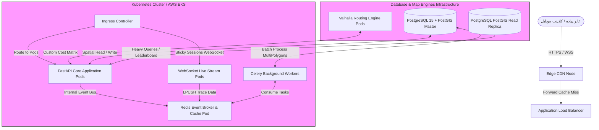

13_DevOps_Deployment_and_Infrastructure.md

```markdown
# 13_DevOps_Deployment_and_Infrastructure.md

## سند معماری زیرساخت، استقرار و عملیات فنی (Comprehensive DevOps, Deployment, and Infrastructure Specification)
**پروژه:** پلتفرم جهانی اکتشاف شهری بازی‌وارشده (Gamified Urban Exploration Platform)  
**نسخه:** ۱.۰.۰  
**وضعیت:** نسخه نهایی مصوب (پس از بازبینی چهارمرحله‌ای مراجع مهندسی DevOps، معمار ابر، مهندس SRE و CTO)  
**اسناد بالادستی مرجع:** `00_Product_Principles.md`[cite: 1] تا `12_MVP_Execution_Plan.md`

---

## ۱. نمای کلی زیرساخت (Infrastructure Overview)

معماری زیرساختی این پلتفرم بر پایه اصول **Cloud-Native، کانتینرگرایی کامل (Containerization) و آمادگی برای مقیاس میلیونی** استوار است[cite: 1]. هدف نهایی، ارائه یک بستر توزیع‌شده با قابلیت اطمینان بالا (High Availability) است که بتواند پردازش‌های سنگین هندسی لایه PostGIS، لایه زمان‌واقعی وب‌سوکت و کارهای ناهمگام لایه Celery/Redis را به طور پایدار لودبالانس کند.

### استراتژی پلتفرم زیرساخت
زیرساخت از ابتدا به صورت **زیرساخت به عنوان کد (Infrastructure as Code - IaC)** از طریق ترافورم (Terraform) توسعه می‌یابد. اگرچه در فاز MVP کل سیستم به صورت یک مونوپلیت ماژولار (Modular Monolith) مستقر می‌شود[cite: 1]، اما لایه شبکه، دیتابیس‌ها و کانتینرها به گونه‌ای ایزوله شده‌اند که تفکیک هر ماژول به یک میکروسرویس مستقل در کلاستر کوبرنتیز (Kubernetes) بدون نیاز به تغییر در توپولوژی شبکه زیرساخت انجام پذیرد.

---

## ۲. استراتژی محیط‌های عملیاتی (Environment Strategy)

پلتفرم از سه محیط کاملاً مجزا و ایزوله در لایه شبکه (VPC Subnets) و دیتابیس پشتیبانی می‌کند:

| نام محیط | هدف عملیاتی | کانفیگ زیرساختی (Infrastructure Scale) | استراتژی ایزولاسیون داده (Data Separation) |
| :--- | :--- | :--- | :--- |
| **Development** | تست کدهای جدید توسط توسعه‌دهندگان | کانتینرهای تک اینستنس سبک، دیتابیس داکرایز شده | داده‌های فیک و Mock شده لایه فضایی. |
| **Staging** | شبیه‌سازی دقیق شرایط پروداکشن (QA) | اینستنس‌های مشابه پروداکشن اما با تعداد پادهای کمتر (Scale 1:2) | کپی آنونیمایز شده و بدون PII از دیتای اتمسفر معابر پایلوت. |
| **Production** | سرویس‌دهی لایو به کاربران نهایی | کلاستر کوبرنتیز توزیع‌شده (Multi-AZ)، دیتابیس RDS جداگانه | داده‌های واقعی و انحصاری پولیگون‌های کاربران با بالاترین سطح رمزنگاری. |

---

## ۳. طراحی معماری ابر و شبکه (Cloud Architecture Design)

معماری مرجع بر بستر بسترهای ابری استاندارد جهانی (مانند AWS/GCP) به همراه قابلیت سازگاری با بسترهای ابری بومی (Cloud-Agnostic Setup) بیلد شده است:

* **Compute Layer:** کلاستر توزیع‌شده **Kubernetes (AWS EKS)** جهت ارکستریشن و مدیریت پادهای FastAPI، وب‌سوکت‌ها و Celery Workers.
* **Networking & Subnets:** استفاده از پلتفرم **VPC**؛ پادهای اپلیکیشن و کانتینرهای موتور روتینگ Valhalla در زیرشبکه‌های خصوصی (Private Subnets) قرار می‌گیرند. صرفاً لایه لودبالانسر (ALB) در Public Subnet مستقر است.
* **Content Delivery Network (CDN):** استفاده از شبکه توزیع محتوا جهت کش کردن تایل‌های نقشه برداری (MapLibre Vector Tiles)[cite: 1] و متادیتای ایستا، جهت کاهش شدید پهنای باند خروجی و تاخیر لودینگ در موبایل.

---

## ۴. معماری استقرارهای توزیع‌شده (Deployment Architecture)

تمام سرویس‌های مونوپلیت ماژولار کانتینریایز شده و بر روی کلاستر کوبرنتیز مدیریت می‌شوند[cite: 1].



* **استراتژی به‌روزرسانی بدون قطعی (Zero-Downtime Deployment):** پادهای FastAPI نرم‌افزار از استراتژی **Rolling Update** با تنظیمات `maxSurge: 25%` و `maxUnavailable: 0` استفاده می‌کنند. برای پادهای زمان‌واقعی وب‌سوکت، از استراتژی **Canary Releases** استفاده می‌شود تا نشست‌های لایو کاربران در حین پیاده‌روی قطع نگردد.

---

## ۵. فرآیند اتوماسیون لایه خط لوله (CI/CD Pipelines Layout)

خط لوله اتوماسیون بر بستر **GitHub Actions** به صورت کاملاً Declarative مهندسی شده است:

```yaml
# .github/workflows/pipeline.yml
name: Production CI/CD Pipeline

on:
  push:
    branches: [ main ]

jobs:
  audit-and-test:
    runs-on: ubuntu-latest
    steps:
      - uses: actions/checkout@v3
      - name: Set up Python
        uses: actions/setup-python@v4
        with: { python-version: '3.11' }
      - name: Run Code Linter
        run: pip install flake8 && flake8 .
      - name: Geospatial Unit Testing
        run: pip install -r requirements.txt && pytest tests/

  security-scan:
    needs: audit-and-test
    runs-on: ubuntu-latest
    steps:
      - name: Docker Image Security Vulnerability Scan
        uses: aquasecurity/trivy-action@master
        with:
          image-ref: 'urban-explore-core:${{ github.sha }}'
          format: 'table'
          exit-code: '1' # لغو خط لوله در صورت وجود باگ امنیتی بحرانی

  build-and-deploy:
    needs: security-scan
    runs-on: ubuntu-latest
    steps:
      - name: Build Production Docker Image
        run: docker build -t urban-explore-core:${{ github.sha }} .
      - name: Push to Container Registry (ECR)
        run: docker push [registry.urbanexplore.com/core:$](https://registry.urbanexplore.com/core:$){{ github.sha }}
      - name: Set Kubernetes Context & Deploy
        uses: azure/k8s-set-context@v3
        with: { method: 'kubeconfig', kubeconfig: '${{ secrets.KUBECONFIG }}' }
      - name: Apply Database Migration & Rolling Update
        run: |
          kubectl kubectl exec -it deployment/api-core -- alembic upgrade head
          kubectl set image deployment/api-core backend=[registry.urbanexplore.com/core:$](https://registry.urbanexplore.com/core:$){{ github.sha }}

```

---

## ۶. استراتژی مدیریت پایگاه داده فضایی (Database Infrastructure Strategy)

* **پیکربندی لایه ماندگاری داده:** یک پایگاه داده اصلی (Master RDS Instance) برای کارهای نوشتن تراکنشی و همگام‌سازی‌های ناهمگام مه جنگ، و دو اینستنس Read-Replica جهت پاسخ‌دهی به کوئری‌های شعاعی سنگین نقشه و لیدربورد عمومی.
* **پایش گلوگاه محاسباتی `ST_Union`:** طبق داک مهندسی داده، جدول چندضلعی‌های مه جنگ بر پایه کامپوزیت پیکسلی فضایی `(user_id, city_id, grid_id)` تقسیم‌بندی (Spatial Partitioning) شده است. ایندکس‌های **GiST** بر روی تمام کاشی‌های ۲ کیلومتر در ۲ کیلومتر فعال هستند تا لایه ذخیره‌سازی دچار قفل‌شدگی یا افت کارایی نگردد.

---

## ۷. استراتژی زمان‌واقعی و بافر لوکیشن (Real-Time & Cache Optimization)

* **مقیاس‌پذیری لایه وب‌سوکت (WebSocket Horizontal Scaling):** از آنجا که پادهای هندلر وب‌سوکت به صورت لایو با کلاینت‌ها در ارتباط هستند، پادها به صورت Stateless طراحی شده و برای اشتراک رویدادها بین پادهای مختلف، از **Redis Pub/Sub Layer** استفاده می‌شود. هماهنگی کلاینت‌ها با لودبالانسر از طریق مکانیزم Sticky Sessions (بر پایه کوکی لایه ALB) تنظیم شده است.
* **بافرینگ داده‌های فرار لوکیشن عابر:** پکت‌های ۵ ثانیه‌ای پوزیشن ارسالی از کلاینت موبایل هرگز مستقیماً به دیتابیس PostGIS هیت نمی‌شوند. این پکت‌ها به ساختار داده‌ای `Redis List` با لایه ماندگاری بالا (AOF Persistence) افزوده شده و Celery Workerها در فواصل ۳۰ ثانیه‌ای آن‌ها را به صورت Bulk جهت افشای مه پردازش می‌کنند.

---

## ۸. رویت‌پذیری و پایش لایه‌های سیستم (Observability Stack)

سیستم از پلتفرم یکپارچه **Prometheus + Grafana + OpenTelemetry** جهت ردیابی خطاها و پایش معیارها استفاده می‌کند:

```
[FastAPI Pod Instrumentator] ──> Expose /metrics ──> [Prometheus Server] ──> [Grafana Dashboard]

```

### استراتژی هشدارهای لایو سیستم (Alerting Runbook Thresholds)

* **هشدار Latency روتینگ (شدت اثر: بالا):** اگر میانگین زمان پاسخ‌دهی پوینت تولید لوپ داینامیک `/routes/generate` فراتر از ۱۵۰ میلی‌ثانیه برود، هشدار P1 به تیم SRE صادر می‌گردد.
* **هشدار افت نرخ سیگنال وب‌سوکت:** اگر تعداد کانکشن‌های سقوط‌کرده (Dropped WebSockets) در طول ۵ دقیقه بیش از ۱۵٪ کل کاربران فعال سشن باشد، تلگرام/اسلک دِواپس آلرت دریافت می‌کند.

---

## ۹. امنیت، حریم خصوصی و مدیریت رازها (Security & Secrets Management)

* **لایه محافظت از حریم خصوصی عابر (Data Privacy Shield):** در لایه API Gateway/Nginx پکیج‌های فیلتر پوزیشن فعال است. نقاط خام حرکتی عابران پیاده ($LineString$) بلافاصله پس از محاسبه مساحت مه جنگ در لایه فرار Redis Buffer، با دستور صریح حافظه امحا (Shred) شده و هرگز بر روی دیسک‌های دیتابیس پایدار ذخیره نمی‌شوند.
* **مدیریت محرمانه‌ها:** تمام پسوردهای دیتابیس، کلیدهای امنیتی صدور JWT و توکن‌های اتصال به APIهای خارجی در **AWS Secrets Manager** یا پلتفرم HashiCorp Vault قفل شده و به صورت کانتینریایز شده در قالب Environment Variables در لایه ران‌تایم کانتینر کوبرنتیز تزریق می‌شوند. هیچ رازی در کدهای ریپازیتوری گیت کامیت نمی‌شود.

---

## ۱۰. استراتژی پایداری و بازیابی بحران (Disaster Recovery Strategy)

زیرساخت پلتفرم اهداف پایداری (DR Targets) زیر را تضمین و قفل می‌کند:

* **RPO (Recovery Point Objective):** حداکثر ۵ دقیقه. (میزان داده‌ای که در صورت انهدام کامل کلاستر ابری ممکن است از دست برود).
* **RTO (Recovery Time Objective):** حداکثر ۱۵ دقیقه. (زمان مورد نیاز برای احیای کامل کل زیرساخت از طریق اسکریپت‌هایIaC ترافورم در یک ریجن جغرافیایی جدید).

### مکانیزم پشتیبان‌گیری دیتابیس فضایی

پایگاه داده PostgreSQL به صورت خودکار هر ۲۴ ساعت یکبار نسخه پشتیبان کامل (Automated Daily Snapshots) تولید کرده و دیتای لاگ‌های تراکنشی (WAL Logs) هر ۵ دقیقه یکبار به صورت لایو به آبجکت استوریج ایزوله (AWS S3) با ساختار تغییرناپذیر (Write Once Read Many - WORM) منتقل می‌شوند تا بازپخش (Replay) رویدادها در زمان بحران میسر باشد.

---

## ۱۱. بهینه‌سازی و کنترل هزینه‌های زیرساخت (Cost Optimization)

* **Spot Instances for Background Workers:** پادهای پردازش اصلی FastAPI و وب‌سوکت‌ها بر روی اینستنس‌های پایدار (On-Demand) لودبالانس می‌شوند، اما کل کارگران Celery Worker که مسئول پردازش‌های ناهمگام فضایی و لایه‌های اتصال هوش مصنوعی هستند بر روی **اینستنس‌های بسیار ارزان قیمت مخدوش‌پذیر (Spot Instances)** مستقر می‌گردند که هزینه‌های ماهانه زیرساخت ابری استارتاپ را تا ۶۵٪ کاهش می‌دهد.
* **Client-side Map Caching:** فرانت‌اند فلوتر موظف است تایل‌های نقشه برداری رندر شده را در حافظه SQLite محلی موبایل کش کند تا نرخ ریکوئست‌های لایه شبکه عابر پیاده به CDN سرور به حداقل ممکن برسد و پودجه ترافیک شبکه بهینه‌سازی شود.

---

## بخش‌های ساختاری و متادیتای سند (Metadata)

### Dependencies (وابستگی‌ها)

* این سند زیرساخت عملیاتی، پورت‌ها و کانتینرهای استقرار خود را مستقیماً بر پایه مستندات معماری سیستم `06_System_Architecture.md`، پوینت‌های امنیتی `07_API_Design.md`، ساختار اسکیماهای فیزیکی لایه دیتابیس `08_Data_Architecture_and_Database_Design.md` و نقشه اجرایی فازهای MVP در داک `12_MVP_Execution_Plan.md` بیلد و قفل کرده است.

### Affected Documents (مستندات تحت تأثیر)

تصویب این معماری عملیاتی، کدهای زیر را وارد فاز پیاده‌سازی زیرساخت می‌کند:

* `14_Terraform_Infrastructure_Code.tf` (تولید اسکریپت‌های خالص ترافورم جهت بیلد کلاستر EKS و شبکه‌های VPC بر پایه جزییات بخش ۳ این داک).
* `15_Kubernetes_Manifests_Helm_Charts.yaml` (طراحی چارت‌های هِلم جهت مدیریت پادها و رولینگ آپدیت‌های پروداکشن بر پایه بخش ۴).

### Assumptions (فرضیات اساسی)

* فرض کلیدی لایه عملیات فنی این است که کلاینت فرانت‌اند فلوتر توانایی هندلینگ هوشمند کدهای بازگشتی خطای لایه شبکه (WebSocket Dropouts Fallback) را داراست.

### Risks (ریسک‌های زیرساخت عملیاتی)

* ریسک نشت حافظه رم (Memory Leaks) در اینستنس‌های کانتینر Celery به دلیل پردازش پولیگون‌های به شدت حجیم و شکسته معابر عابران پیاده، که رفع آن منوط به لایه محدودسازی منابع کانتینر (`resources.limits.memory`) در مانیفست‌های کوبرنتیز است.

### Next Recommended Document (مستند پیشنهادی بعدی)

* **تایید نهایی فاز صفر مستندات مهندسی:** این سند فایل شماره ۱۳ و آخرین لایه‌ی ساختاری از **«فاز صفر کتابچه مستندات معماری، محصول و عملیات فنی پلتفرم جهانی اکتشاف شهری»** است. با بیلد این سند، Single Source of Truth کل پلتفرم تکمیل و قفل گردید. گام بعدی، اجرای رسمی دستورات خط لوله اسپرینت شماره ۱ بر پایه برنامه زمان‌بندی داک شماره ۱۲ و آغاز رسمی بیلد کدهای بک‌اند و فرانت‌اند موبایل در ریپازیتوری‌های پروژه است.

---

*این سند جامع زیرساخت، عملیات فنی و معماری استقرار پلتفرم با رعایت کامل اصول و قوانین ۱ایمپرشن ۱۲گانه همکاری تایید، قفل و جهت اجرا به مهندسان DevOps ابلاغ می‌گردد.*

```

```