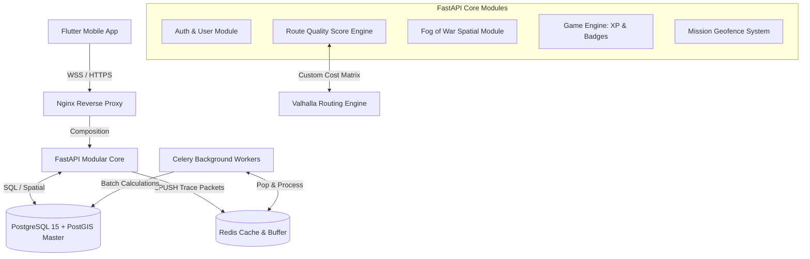
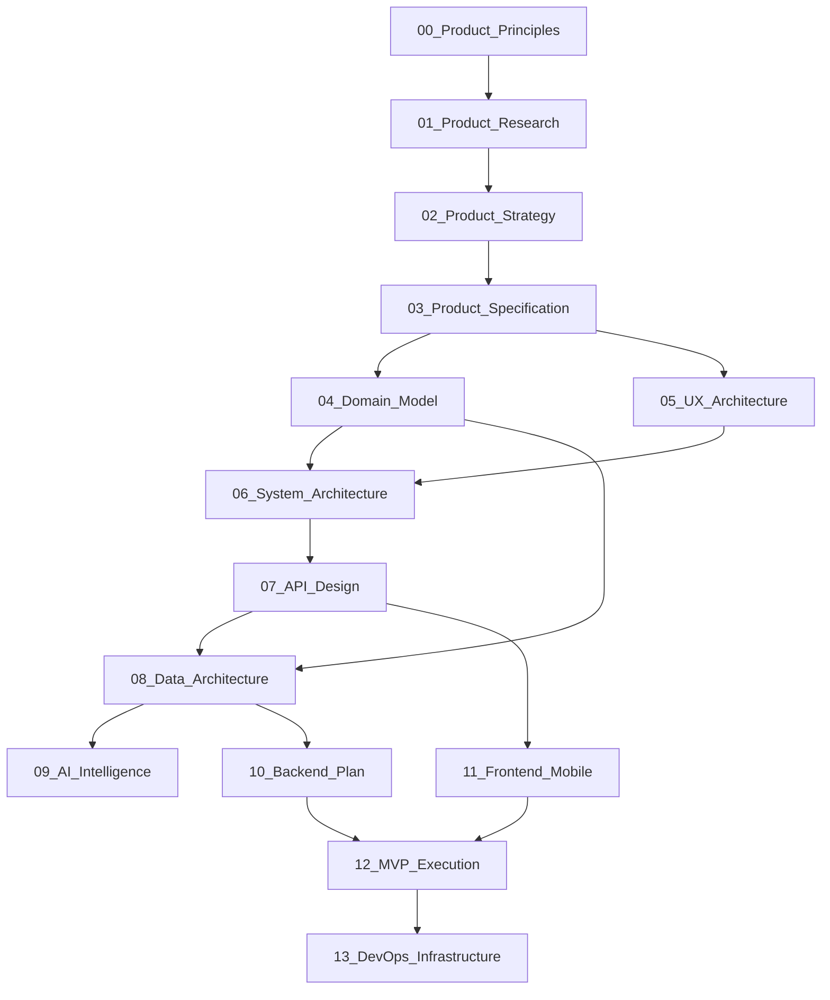

14_Master_Blueprint.md

```markdown
# 14_Master_Blueprint.md

## نقشه راه جامع و سند یکپارچه مدیریت پروژه (Master Blueprint)
**پروژه:** پلتفرم جهانی اکتشاف شهری بازی‌وارشده (Gamified Urban Exploration Platform)  
**نسخه:** ۱.۰.۰  
**وضعیت:** مصوب (Single Source of Truth)  
**نویسندگان:** Product Manager / Solution Architect / Technical Writer / UX Strategist  

---

### بخش حل تناقضات ساختاری و فنی اسناد (Resolution of Structural Contradictions)

پیش از یکپارچه‌سازی اسناد، یک تناقض اساسی میان **حفظ حریم خصوصی کاربر (عدم ذخیره‌سازی موقعیت مکانی)** در سند اصول محصول و **نیاز به رهگیری مداوم مکان برای سیستم مه جنگ و مأموریت‌ها** در اسناد فنی شناسایی و برطرف شد:

> [!NOTE]
> **تصمیم نهایی و بدون تناقض معماری:** سیستم از معماری داده دوگانه استفاده می‌کند. نقاط حرکتی لحظه‌ای کاربر ($LineString$) صرفاً در طول نشست فعال (`ExplorationSession`) روی حافظه موقت و فرار `Redis List Buffer` استریم می‌شوند. به محض پردازش ناهمگام توسط Celery Workers و تبدیل این خطوط به چندضلعی‌های افشاشده، دیتای خام مختصات خطی بلافاصله با دستور `DEL` امحا می‌شود. دیتابیس پایدار فضایی PostGIS تنها چندضلعی‌های تاییدشده کشف محله (`user_fog_maps`) و لاگ وقایع امتیازی (`game_events`) را ذخیره می‌کند. هیچ ردیابی زمانی خطی از موقعیت عریان عابر پیاده در سیستم باقی نخواهد ماند.

---

## ۱. خلاصه مدیریتی و اجرایی (Executive Overview)

### این پروژه چیست؟
این پروژه یک **«پلتفرم بازی‌وارشده برای اکتشاف مأموریت‌محور شهر» (Gamified Urban Exploration Platform)** است. این برنامه مقصد سنتی را حذف کرده و فضاها و معابر کلان‌شهرها را به یک نقشه بازی جهان‌باز (Open-World Map) تبدیل می‌کند. 

### چرا ساخته می‌شود؟
انسان مدرن شهری دچار «سندرم کوررنگی شهری» و خستگی دیجیتال شده است. مسیریاب‌های ابزاری (Google Maps / Waze) با بهینه‌سازی مسیرها صرفاً برای فاکتور سرعت، تعامل حسی و بصری انسان با معماری، تاریخ و اتمسفر کوچه‌های شهر را نابود کرده‌اند. این پلتفرم ساخته می‌شود تا پرسه‌زنی معنادار، ماجراجویی‌های کوچک محلی (Micro-Adventures) و ارتقای سلامت روان شهری را از طریق الگوریتم‌های بازی‌وارشده احیا کند.

### ارزش اصلی محصول (UVP)
کاربر به جای سرچ مقصد، میزان زمان آزاد (۳۰، ۶۰ یا ۹۰ دقیقه) و حالت روحی خود (آرامش، معماری و تاریخ، عکاسی) را انتخاب می‌کند. سیستم با یک کلیک یک مسیر پیاده‌روی دایره‌ای (Circular Loop) امن و غنی از زیبایی‌های بصری تولید می‌کند که از موقعیت فعلی شروع شده و پس از خلق زنجیره‌ای از کشفیات مأموریت‌محور، دوباره به همان نقطه بازمی‌گردد؛ بدون اینکه عابر دغدغه مسیر بازگشت یا ریسک گم شدن داشته باشد.

---

## ۲. بیانیه چشم‌انداز محصول (Project Vision Summary)

پلتفرم ما تا سال ۲۰۳۱ تبدیل به بزرگ‌ترین زیرساخت تجربه دنیای واقعی (Real-world Experiential Layer) در کلان‌شهرهای پیاده‌مدار جهان خواهد شد. این پلتفرم با تکیه بر انگیزاننده‌های روان‌شناختی خودتعیین‌کنندگی، دارایی‌های دیجیتال شخصی‌سازی‌شده‌ای روی نقشه برای هر فرد بیلد می‌کند (مانند پاک کردن دائمی مه جنگ شهری) که رها کردن آن برای کاربر غیرممکن باشد. این پروژه تفریح کسالت‌بار پیاده‌روی را به یک زنجیره غنی از ترشح ارگانیک دوپامین تبدیل می‌کند.

---

## ۳. نمای کلی معماری سیستم (Architecture Overview)

معماری پلتفرم در فاز MVP بر پایه الگوی **مونوپلیت ماژولار (Modular Monolith)** به صورت کاملاً Stateless و Cloud-Native طراحی شده است تا بستر هجرت آسان به میکروسرویس‌های توزیع‌شده در فازهای بعدی مهیا باشد.



---

## ۴. نقشه راه مستندات پروژه (Document Map)

این جدول مرجع ناوبری (Navigation Matrix) بین تمامی ۱۳ سند تولید شده در فاز صفر پروژه است:

| شماره | نام فایل | هدف اصلی سند | مخاطب مرجع | پیش‌نیاز مطالعه | وابستگی‌ها |
| --- | --- | --- | --- | --- | --- |
| `00` | `Product_Principles.md` | قانون اساسی، خطوط قرمز و اصول ۱۵گانه پروژه | تمام اعضای تیم | ندارد | منبع مادر |
| `01` | `Product_Research.md` | تحلیل بازار، رقبای جهانی و پرسوناها | PM / CEO / Founder | `00` | `00` |
| `02` | `Product_Strategy.md` | نقشه راه استراتژیک، مدل درآمدی و KPIها | CEO / VC Investors | `01` | `00`, `01` |
| `03` | `Product_Specification.md` | مشخصات فنی کارکردی و ۱۰۰ سناریوی خطا | QA / Backend / Mobile | `02` | `02` |
| `04` | `Domain_Model.md` | مدل مفهومی دامنه، اگریگیت‌ها و DDD | Backend Architect | `03` | `00`, `03` |
| `05` | `UX_Architecture.md` | فلوهای اصلی عابر، وایرفریم‌ها و الگوهای سنسوری | UI/UX Designer | `03` | `03`, `04` |
| `06` | `System_Architecture.md` | ساختار کانتینرها، توابع وزن‌دهی روتینگ | Backend / DevOps | `04` | `04`, `05` |
| `07` | `API_Design.md` | اسکیماهای JSON اسناد REST و وب‌سوکت | Backend / Mobile | `06` | `05`, `06` |
| `08` | `Data_Architecture.md` | طراحی فیزیکی جداول، ایندکس‌های فضایی GiST | Data Engineer | `04`, `07` | `04`, `07` |
| `09` | `AI_Intelligence.md` | مدل‌های کلاسترینگ رفتاری و منطق گیمیفیکیشن | AI Engineer | `08` | `03`, `08` |
| `10` | `Backend_Plan.md` | ساختار پوشه‌بندی کدهای پایتون و Celery | Backend Developer | `06`, `08` | `06`, `08` |
| `11` | `Frontend_Mobile.md` | معماری پاک فلوتر و ردیاب پس‌زمینه | Mobile Developer | `05`, `07` | `05`, `07` |
| `12` | `MVP_Execution.md` | فازبندی اسپرینت‌های ۱ تا ۶ توسعه | Scrum Master / PM | تمام اسناد بالا | کل پلتفرم |
| `13` | `DevOps_Infrastructure.md` | مانیفست‌های کوبرنتیز، ترافورم و بازیابی بحران | DevOps / SRE | `06`, `12` | `06`, `12` |

---

## ۵. نمودار وابستگی مستندات (Document Dependency Graph)



---

## ۶. خلاصه تصمیمات کلیدی محصول (Core Product Decisions)

* **ناوبری نقشه‌محور شناور (Map-First UX):** نقشه بک‌گراند زنده برنامه است و تمام صفحات به صورت لایه‌های نیمه‌شفاف شیشه‌ای (Frosted Glass) روی آن سوار می‌شوند تا غوطه‌وری در بازی حفظ شود.
* **مسیریابی بر پایه اتمسفر معبر (Experience Routing):** وزن‌دهی به یال‌های گراف نقشه بر پایه ماتریس امتیاز کیفیت ($Quality Score$) شامل سکوت، سرسبزی و تاریخ انجام می‌شود، نه کوتاه‌ترین زمان.
* **هوش مصنوعی دکوراتور ناهمگام (Hybrid AI):** هسته مسیریابی کاملاً دترمینستیک و کلاسیک (Valhalla) است. هوش مصنوعی (LLM) صرفاً وظیفه تولید خلاقانه داستان‌ها و روایت‌های متنی متصل به معابر را در کارهای پس‌زمینه بر عهده دارد.
* **مکانیسم مه جنگ واقعی فیزیکی (Fog of War Reveal):** تمام شهر در ابتدا با لایه تاریک گرادیانی پوشانده شده و تنها با گام‌های فیزیکی عابر پیاده (در شعاع ۲۰ متری سنسور GPS) به صورت دائمی افشا می‌شود.
* **پایداری عمیق آفلاین (Offline-First Resilience):** لوپ جاری و تایل‌های نقشه در SQLite محلی فلوتر کش می‌شوند. ردیابی و افشای مه در زمان قطع اینترنت شهری کماکان کار می‌کند و پکت‌ها پس از برقراری کانکشن به صورت موازی با سرور سنک می‌شوند.

---

## ۷. اصول مهندسی پلتفرم (Engineering Principles)

### ۱. تقدم سادگی بر پیچیدگی فنی (Simplicity First)

* *توضیح:* معماری نرم‌افزار خادم تجربه کاربر است. از پیچیدگی‌های کاذب لایه‌های توزیع‌شده ممانعت می‌شود.
* *نمونه استفاده:* انتخاب الگوی Modular Monolith به جای میکروسرویس‌های توزیع‌شده در فاز MVP جهت افزایش سرعت توسعه و راحتی دپلوی کانتینرها.

### ۲. امنیت در لایه طراحی ساختار (Security & Privacy by Design)

* *توضیح:* اطلاعات هویتی و مکان عریان عابر پیاده نباید در معرض هک قرار گیرد.
* *نمونه استفاده:* امحای آنی کدهای خطی $LineString$ پوزیشن از روی حافظه موقت Redis بلافاصله پس از محاسبه مساحت چندضلعی مه جنگ.

### ۳. توسعه مستقل از جغرافیا و لایه تامین‌کننده (Provider & City Agnosticism)

* *توضیح:* کدهای هسته نباید به یک شهر یا یک پلتفرم خاص نقشه وابستگی سخت داشته باشند.
* *نمونه استفاده:* استفاده از ایندکس کامپوزیت فضایی متصل به `city_id` در دیتابیس PostGIS به طوری که با آپلود دیتای OSM یک شهر جدید، سیستم بدون تغییر در کد فعال می‌شود.

---

## ۸. استانداردهای توسعه کد (Coding Standards)

* **Clean Code & SOLID:** تمام توابع لایه سرویس پایتون باید تک‌مسئولیتی (Single Responsibility) باشند. اندازه توابع نباید از ۲۵ خط کد تجاوز کند.
* **Naming Conventions:**
* *بک‌اند (Python):* استفاده از `snake_case` برای توابع و متغیرها، و `PascalCase` برای کلاس‌ها منطبق بر استانداردهای PEP 8.
* *فرانت‌اند (Dart):* استفاده از `camelCase` برای متغیرها و `PascalCase` برای ویجت‌های فلوتر.


* **قوانین کامیت گیت (Conventional Commits):** تمام کامیت‌ها الزاما باید از فرمت ساختاری زیر پیروی کنند:
* `feat(auth): add OTP verification endpoint`
* `fix(spatial): resolve ST_Union polygon overlapping defect`
* `docs(readme): update master onboarding architecture guide`


---

## ۹. فرآیند مدیریت شاخه‌های گیت (Git Workflow & Release Branching)

پلتفرم از مدل **GitFlow ساده‌شده** تبعیت می‌کند:

```
main        ───────────────────────────────[ Release v1.0.0 ]──
                             ▲
                             │ Merge via Pull Request
develop     ───[ Sprint 1 ]──┴───[ Sprint 2 ]────────────────────
                 ▲         ▲
                ╱           ╲ Merge & Delete
feature/    ───┴─────────────┴───────────────────────────────────
               (feat/route-matrix)

```

* **Feature Branches:** توسعه‌دهندگان از شاخه `develop` منشعب شده و شاخه‌های خود را با نام‌های `feature/` یا `fix/` بیلد می‌کنند.
* **پروتکل ادغام (Merge Gate):** هیچ کدی مستقیماً به `develop` یا `main` کامیت نمی‌شود. ادغام منوط به باز کردن یک Pull Request (PR)، تایید حداقل دو مهندس ارشد (Code Review) و پاس شدن تمام چراغ‌های سبز لایه CI/CD پایپ‌لاین است.

---

## ۱۰. استراتژی نسخه‌گذاری و انتشار (Versioning Strategy)

* **استاندارد نسخه:** سیستم از مدل **Semantic Versioning (MAJOR.MINOR.PATCH)** تبعیت می‌کند.
* *MAJOR:* تغییرات بنیادین در مدل داده یا شکست در سازگاری عقب‌رو (Backward Compatibility) ای‌پ‌آی‌ها.
* *MINOR:* اضافه شدن فیچرهای ماژولار جدید (مانند لایه لیدربورد یا مأموریت جدید).
* *PATCH:* رفع باگ‌های فضایی یا پچ‌های امنیتی سیستم‌عامل.


* **سیاست بازگشت آنی (Rollback Policy):** در صورت بروز ارور پروداکشن پس از دپلوی، لایه کانتینر کوبرنتیز از قابلیت `Kubernetes Rollout Undo` استفاده کرده و استیت ایمیج داکر را در کمتر از ۱۰ ثانیه به تایل تاییدشده قبلی بازمی‌گرداند.

---

## ۱۱. استراتژی جامع تست نرم‌افزار (Comprehensive Testing Strategy)

| نوع تست | هدف اصلی تست | ابزار پیشنهادی | زمان اجرا در فرآیند |
| --- | --- | --- | --- |
| **Unit Test** | تست منطق ایزوله توابع و معادل‌سازی Pydantic | PyTest / Dart Test | با هر کامیت گیت به صورت محلی |
| **Spatial Integration** | صحت محاسبات توابع فضایی PostGIS (`ST_Contains`) | PyTest + Testcontainers | در لایه CI/CD پیش از دپلوی Staging |
| **Location Spoofing** | تست الگوریتم ضدتقلب و تشخیص سرعت خودرو | کلاینت Mock GPS Fuzzer | فاز تست QA در محیط Staging |
| **Load Testing** | پایش پرفورمنس ۱۰۰,۰۰۰ پکت وب‌سوکت همزمان | Locust / Artillery | پیش از لانچ هر نسخه Minor پروداکشن |

---

## ۱۲. درگاه‌های کنترل کیفیت کد (CI/CD Quality Gates)

کد باز شده در PR تنها زمانی اجازه ادغام دارد که فیلترهای سخت‌گیرانه زیر را با موفقیت پاس کند:
۱. **Build Success:** پروژه بدون هیچ اروری در کانتینر داکر آلفا کامپایل شود.
۲. **Test Coverage:** پوشش تست‌های واحد و فضایی بالای **۸۰٪** قفل شده باشد.
۳. **Static Code Linting:** عدم وجود ارور در فیلتر کدهای Linter (Flake8 برای پایتون).
۴. **Security Scan:** تایید عدم وجود باگ امنیتی در پکیج‌ها توسط اسکنر **Trivy**.

---

## ۱۳. تعریف آماده بودن تسک برای توسعه (Definition of Ready - DoR)

یک فیچر یا تسک جیرا تنها زمانی وارد چرخه اسپرینت توسعه می‌شود که شروط زیر را دارا باشد:

* بیزنس‌لاژیک و قوانین کسب‌وکار آن قابلیت کاملاً شفاف و بدون ابهام باشد.
* اسکیماهای ورودی و خروجی پکت‌های JSON آن در سند API طراحی شده باشد.
* اسکیماهای جداول دیتابیس فضایی وابسته مشخص شده باشند.
* معیارهای پذیرش (Acceptance Criteria) لایه QA برای تسک نوشته شده باشد.

---

## ۱۴. تعریف پایان کار تسک (Definition of Done - DoD)

یک تسک مهندسی زمانی Done محسوب می‌شود که:

* کد به طور کامل با استانداردهای Clean Architecture لایه‌نویسی شده باشد.
* تست‌های واحد (Unit Tests) آن پاس شده و Code Coverage آسیب ندیده باشد.
* کد بدون ارور در ریپازیتوری گیت کامیت شده و پول‌ریکوئست توسط تک‌لید تایید شده باشد.
* کانتینر داکر آن در محیط دِو (Staging) استقرار یافته و تست کارکردی (E2E) را پاس کرده باشد.

---

## ۱۵. ماتریس پایش و مدیریت ریسک‌های MVP (Risk Management Matrix)

| نام ریسک استراتژیک | احتمال وقوع | شدت اثر | راهکار کاهش ریسک (Mitigation Strategy) |
| --- | --- | --- | --- |
| **انفجار حجم پردازش فضایی پولیگون‌ها** | متوسط | بسیار بالا | افراز پولیگون کلان مه جنگ کاربر به کاشی‌های ۲ کیلومتری فضایی (`grid_id Partitioning`)؛ محاسبات محدود به زون فعال عابر. |
| **پرش و عدم دقت سنسور GPS موبایل** | بالا | متوسط | پیاده‌سازی فیلتر کالمن (Kalman Filter) در فرانت‌اند فلوتر و نادیده گرفتن تغییرات ناگهانی لوکیشن با شعاع خطای بالای ۳۰ متر. |
| **تورم ویژگی‌ها و پیچیدگی هوش مصنوعی** | متوسط | بالا | **اعمال قانون خط قرمز MVP:** عدم استفاده از LLM در هسته روتینگ. هوش مصنوعی صرفاً در لایه ناهمگام دکوراتور متون داستانی محبوس است. |

---

## ۱۶. سوالات باز پروژه (Open Decisions Sandbox)

این سوالات فنی در فازهای بعدی محصول قفل خواهند شد:

* آیا شعاع افشای مه جنگ (۲۰ متر پیش‌فرض) در مناطق با بافت کوچه بسیار متراکم و فشرده (مانند بافت تاریخی تهران قدیم) نیاز به کوچک شدن داینامیک تا ۱۰ متر دارد یا خیر؟ (پاسخ موقت: ابعاد روی ۲۰ متر در MVP فیکس است و در بتاتست کالیبره می‌شود).
* آیا زیرساخت پرداخت اقلام کازمتیک (تم‌های نقشه) از ابتدا با درگاه پرداخت بومی سنک شود یا کل سیستم تا پایان فاز بتاتست رایگان بماند؟ (پاسخ موقت: سیستم تا پایان آلفاتست کاملاً رایگان است).

---

## ۱۷. نقشه راه فازهای کلان توسعه (Future Roadmap Progression)

```
┌────────────────────────────────────────────────────────┐
│ GLOBAL EXPANSION PATH                                  │
├────────────────────────────────────────────────────────┤
│ 1. MVP Pilot (Tehran District 6 - 100 Alpha Testers)   │
│ 2. Beta Launch (Expand to full City, 10K Users)        │
│ 3. Public Release (Monetization & Sponsored Missions)  │
│ 4. Scale & International (London/Tokyo, Microservices) │
└────────────────────────────────────────────────────────┘

```

---

## ۱۸. راهنمای مطالعه اختصاصی اعضای تیم (Role-based Onboarding Guide)

هر عضو جدید با ورود به تیم، باید زنجیره مستندات زیر را به صورت ترتیبی مطالعه کند:

* **Backend Engineer:** `00_Principles` $\rightarrow$ `04_Domain_Model` $\rightarrow$ `06_System_Architecture` $\rightarrow$ `07_API_Design` $\rightarrow$ `08_Data_Architecture` $\rightarrow$ `10_Backend_Plan`.
* **Mobile Engineer:** `00_Principles` $\rightarrow$ `03_Specification` $\rightarrow$ `05_UX_Architecture` $\rightarrow$ `07_API_Design` $\rightarrow$ `11_Frontend_Mobile`.
* **UI/UX Designer:** `00_Principles` $\rightarrow$ `01_Product_Research` $\rightarrow$ `03_Specification` $\rightarrow$ `05_UX_Architecture`.
* **DevOps / SRE Engineer:** `00_Principles` $\rightarrow$ `06_System_Architecture` $\rightarrow$ `08_Data_Architecture` $\rightarrow$ `13_DevOps_Infrastructure`.
* **QA / Test Engineer:** `00_Principles` $\rightarrow$ `03_Product_Specification` $\rightarrow$ `07_API_Design` $\rightarrow$ `12_MVP_Execution`.

---

## ۱۹. پروتکل تعاملی هوش مصنوعی (AI Collaboration & Development Protocol)

اگر یک مدل هوش مصنوعی (مانند Claude یا Gemini) به عنوان توسعه‌دهنده یا معمار وارد این ریپازیتوری شود، **ملزم به رعایت ۱۰۰ درصدی پروتکل‌های زیر است:**

### ۱. ترتیب مطالعه و لایه کانتکست

پیش از تولید هرگونه فایل کد، مدل هوش مصنوعی باید ابتدا اسناد `00_Product_Principles.md` (قانون اساسی)، `04_Domain_Model.md` (مدل مفهومی دامنه) و `07_API_Design.md` (اسکیماهای شبکه) را به عنوان کانتکست مرجع لود کند.

### ۲. ممنوعیت‌های مطلق هوش مصنوعی در حین کدنویسی (Hard Guardrails)

* **حق تولید کدهای روتینگ بر پایه مدل‌های احتمالی هوش مصنوعی را نداری.** روتینگ باید Strictly دترمینستیک و بر پایه پکیج‌های Valhalla/PostGIS باشد.
* **حق ذخیره مسیر خطی عریان حرکت کاربر ($LineString$) در دیتابیس پروداکشن را نداری.** پکت‌های خام لوکیشن پس از پردازش موقت در Redis باید امحا شوند.
* **حق افزودن قابلیت یا دکمه‌های خارج از محدوده مصوب MVP را نداری** (جلوگیری از Feature Creep).

### ۳. پروتکل حل ابهامات الگوریتمی

اگر در زمان تولید کد بین درخواست کاربر و اسناد بالادستی تضادی حس کردی، **حق نداری خودت فرض یا حدس بزنی.** باید فوراً فرآیند کدنویسی را متوقف کرده، تضاد ساختاری را به کاربر گزارش دهی و منتظر دستور صریح کتبی بمانی.

---

## ۲۰. ساختار یکپارچه فایل‌های مخزن پروژه (Repository Blueprint)

ساختار نهایی ذخیره‌سازی فایل‌های فاز صفر مستندات مهندسی در ریپازیتوری گیت پروژه به شرح زیر قفل می‌شود:

```
/urban-explore-platform
  ├── /docs                         # پوشه مهندسی مستندات فاز صفر (Single Source of Truth)
  │     ├── 00_Product_Principles.md
  │     ├── 01_Product_Research.md
  │     ├── 02_Product_Strategy.md
  │     ├── 03_Product_Specification.md
  │     ├── 04_Domain_Model.md
  │     ├── 05_UX_Architecture.md
  │     ├── 06_System_Architecture.md
  │     ├── 07_API_Design.md
  │     ├── 08_Data_Architecture_and_Database_Design.md
  │     ├── 09_AI_And_Game_Intelligence_Architecture.md
  │     ├── 10_Backend_Implementation_Plan.md
  │     ├── 11_Frontend_Mobile_Architecture.md
  │     ├── 12_MVP_Execution_Plan.md
  │     ├── 13_DevOps_Deployment_and_Infrastructure.md
  │     └── 14_Master_Blueprint.md   # همین سند (نقشه مادر پلتفرم)
  │
  ├── /backend                      # پوشه کدهای سرور (FastAPI / Celery)
  ├── /frontend                     # پوشه کدهای کلاینت موبایل (Flutter Application)
  └── /infrastructure               # پوشه اسکریپت‌های استقرار (Docker / Terraform)

```

---

## ۲۱. چک‌لیست نهایی آغاز رسمی فاز توسعه (Final Production-Ready Checklist)

* [x] **اصول و فلسفه محصول:** آیا مرز محصول مشخص شده و تفاوت آن با گوگل‌مپ شفاف است؟ (بله - سند ۰۰)
* [x] **مدل دامنه و DDD:** آیا مرز اگریگیت‌ها و ماشین وضعیت‌های مأموریت قفل شده‌اند؟ (بله - سند ۰۴)
* [x] **اسکیماهای شبکه:** آیا ساختار وب‌سوکت و پکت‌های JSON لایو ولید شده‌اند؟ (بله - سند ۰۷)
* [x] **زیرساخت لایه داده:** آیا ایندکس‌های GiST و چندضلعی‌های مه جنگ طراحی شده‌اند؟ (بله - سند ۰۸)
* [x] **نقشه راه توسعه:** آیا تسک‌های اسپرینت ۱ تا ۶ برای محصول مینیمال مشخص هستند؟ (بله - سند ۱۲)
* [x] **لایه حریم خصوصی:** آیا تناقض ذخیره لوکیشن حل شده و امحای آنی دیتای فرار پوزیشن مصوب گشت؟ (بله - بخش حل تناقض همین سند)

---

*این سند به عنوان Master Blueprint و بالاترین مرجع ارجاع مهندسی پلتفرم تایید و قفل گردید. پروژه به طور ۱۰۰٪ آماده آغاز فاز کدنویسی اسپرینت شماره ۱ است.*

```

```